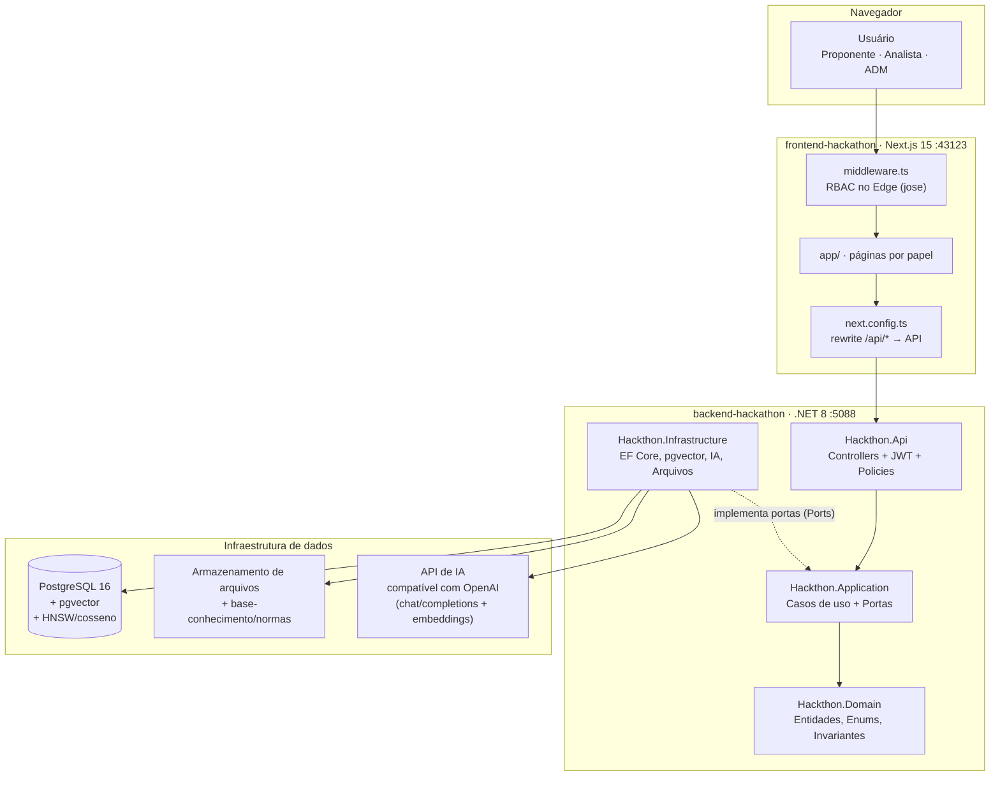
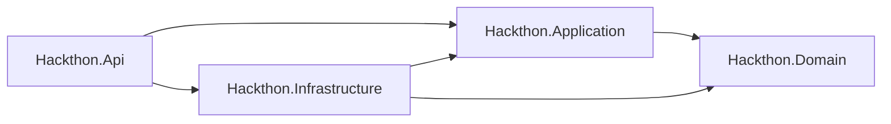
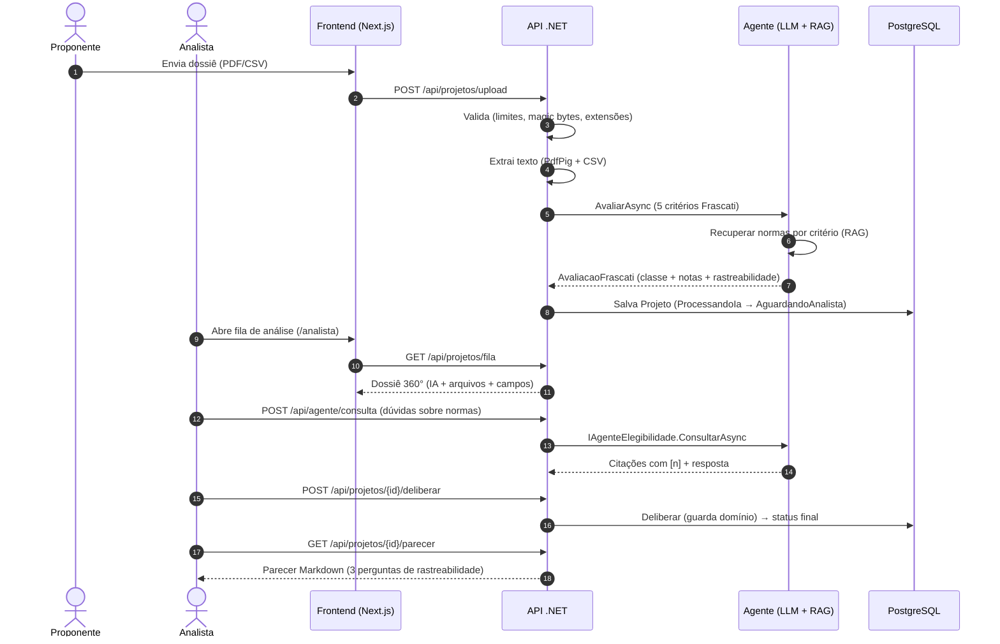
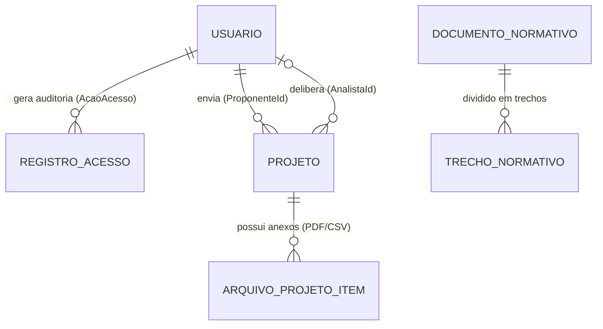
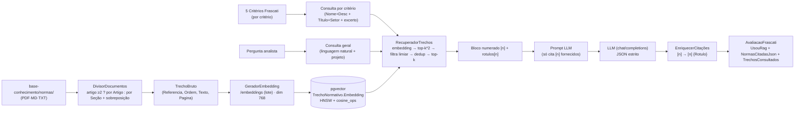

# Guia de Estudos — Hackathon STS 2026 (Lei do Bem)

> Trilha para entender o que foi construído neste repositório: um **sistema de apoio à decisão para análise preliminar de elegibilidade à Lei do Bem (Lei 11.196/2005)**, feito no Hackathon STS 2026 (Banco do Nordeste). A IA **apoia**; a decisão final é sempre do analista humano.

Este guia foi escrito para quem está entrando no projeto agora. Siga as fases na ordem: cada uma tem **objetivo**, **pré-requisitos**, **o que ler** (com caminhos reais), **anatomia detalhada**, **o que executar**, **exercícios práticos** e um **checkpoint** — só avance quando conseguir explicar ou executar o checkpoint com segurança.

**Tempo estimado:** ~6–8 horas por fase (para quem já programa). Se for seu primeiro contato com Clean Architecture + RAG + pgvector, reserve um pouco mais.

---

## Índice

- [Mapa visual (Mermaid)](#mapa-visual-mermaid)
- [0. Visão geral do repositório](#0-visão-geral-do-repositório)
- [Fase 0 — Contexto de negócio (essencial)](#fase-0--contexto-de-negócio-essencial)
- [Fase 1 — Panorama da solução (arquitetura)](#fase-1--panorama-da-solução-arquitetura)
- [Fase 2 — Rodar tudo de pé (ambiente local)](#fase-2--rodar-tudo-de-pé-ambiente-local)
- [Fase 3 — Domain (o coração das regras e invariantes)](#fase-3--domain-o-coração-das-regras-e-invariantes)
- [Fase 4 — Application (casos de uso e orquestração)](#fase-4--application-casos-de-uso-e-orquestração)
- [Fase 5 — Infrastructure (persistência, auth, arquivos, IA e composição)](#fase-5--infrastructure-persistência-auth-arquivos-ia-e-composição)
- [Fase 6 — RAG / Base de Normas (pgvector + indexação + recuperação)](#fase-6--rag--base-de-normas-pgvector--indexação--recuperação)
- [Fase 7 — Frontend (Next.js, RBAC, dossiê do analista e UX)](#fase-7--frontend-nextjs-rbac-dossiê-do-analista-e-ux)
- [Fase 8 — Dados + validação com os históricos (PRJ01–PRJ40)](#fase-8--dados--validação-com-os-históricos-prj01prj40)
- [Checklist final de conceitos](#checklist-final-de-conceitos)
- [Caminhos de aprofundamento](#caminhos-de-aprofundamento)
- [Apêndice A — Formato dos CSVs (referência rápida)](#apêndice-a--formato-dos-csvs-referência-rápida)
- [Apêndice B — Glossário de termos (Lei do Bem + Frascati)](#apêndice-b--glossário-de-termos-lei-do-bem--frascati)

---

## Mapa visual (Mermaid)

> Os diagramas abaixo usam **Mermaid**. O GitHub renderiza automaticamente; no VS Code instale a extensão "Markdown Preview Mermaid Support".

### Arquitetura geral (contêineres)



### Camadas do backend (dependência unidirecional)



### Fluxo ponta a ponta



### Modelo de dados (principais entidades)



> Tabelas mapeadas no EF Core: `usuarios`, `registros_acesso`, `projetos`, `arquivos_projeto`, `documentos_normativos`, `trechos_normativos`. Enums gravados como texto (`character varying`). Coluna `Embedding` em `trechos_normativos` é `vector(768)` (pgvector).

---

## 0. Visão geral do repositório

Monorepo com quatro blocos:

| Bloco | Pasta | Tecnologia |
| :-- | :-- | :-- |
| **Backend** | `backend-hackathon/` | .NET 8 (C# 12), ASP.NET Core, EF Core 8, PostgreSQL 16 + `pgvector`, JWT, xUnit |
| **Frontend** | `frontend-hackathon/` | Next.js 15 (App Router), TypeScript 5, Chakra UI v3, Tailwind v4, `jose` (JWT Edge) |
| **Dados do desafio** | `HACKATHON STS 2026-pacote_participantes_lei_do_bem_v10/` | 40 projetos fictícios (PRJ01–PRJ40), CSVs, PDFs, guias |
| **Infra** | `docker-compose.yml` (raiz) | `db` (Postgres+pgvector, porta `54329`), `api` (`5088`), `web` (`43123`) |

> **Atenção:** existe uma pasta `backend-hackthon/` (sem "a") contendo apenas `Hackthon.Infrastructure/obj`. É duplicata acidental — ignore-a nos estudos.

**Solução .NET (4 projetos):**

```text
Hackthon.sln
├─ src/Hackthon.Api              → Camada de apresentação (Controllers, Auth, Middlewares, Contratos HTTP)
├─ src/Hackthon.Application      → Casos de uso (Serviços), Portas (Interfaces), Comum (Resultado)
├─ src/Hackthon.Domain           → Núcleo de negócio (Entidades ricas, Enums, Invariantes)
└─ src/Hackthon.Infrastructure   → Implementações (EF Core, Repositórios, IA/LLM, RAG, Arquivos, Auth)
```

Dependência unidirecional estrita: `Api → Application → Domain`. `Infrastructure` implementa portas definidas em `Application` (Inversão de Dependência). 

**Princípios adotados:**
- Clean Architecture + DDD (entidade rica no Domain)
- Sem exceções para fluxo de negócio: `Resultado<T>` (Application/Api)
- Ports & Adapters (interfaces em Application, impl em Infrastructure)
- RBAC em 3 níveis: Edge (Next middleware) → Políticas ASP.NET (.NET) → Guardas de Domínio
- IA como **apoio** (nunca decisão automática irreversível). Fallback determinístico (heurístico) quando LLM/RAG indisponíveis.

### Fluxo de estados (resumo)

```text
ProcessandoIa → AguardandoAnalista → (Elegivel | ComRessalvas | NaoElegivel | EvidenciaInsuficiente | Reanalise)
Reanalise → ProcessandoIa (novo envio)
```

Guardas de domínio impedem conclusões sem rastreabilidade (evidências por ID, campos obrigatórios por classe).

---

## Fase 0 — Contexto de negócio (essencial)

**Objetivo:** dominar Lei do Bem, Manual de Frascati e as 4 classes de decisão. Sem isso, o código não faz sentido.

### Pré-requisitos
N/A (leitura pura).

### Ler (obrigatório)

| Arquivo | Por quê? |
| :-- | :-- |
| `HACKATHON STS 2026-pacote_participantes_lei_do_bem_v10/GUIA_DO_PARTICIPANTE.md` | **Comece aqui.** Define as 4 classes, critérios, evidências, armadilhas e regras de julgamento. |
| `HACKATHON STS 2026-pacote_participantes_lei_do_bem_v10/LEIA_ME.md` | Regras técnicas dos arquivos (CSV/XLSX), separadores, cabeçalhos, como interpretar `medicoes.csv`, `resultados.csv`, `base_de_calculo`. |
| `HACKATHON STS 2026-pacote_participantes_lei_do_bem_v10/historicos_classificados.md` | Gabarito com justificativas. Essencial para validar entendimento. |
| `HACKATHON STS 2026-pacote_participantes_lei_do_bem_v10/historicos_classificados.csv` | Versão estruturada para comparação quantitativa (Fase 8). |

### Estudo dos históricos (obrigatório)

Leia pelo menos **6 casos**, cobrindo **todas as 4 classes**:

| Classe | Casos sugeridos | Foco de análise |
| :-- | :-- | :-- |
| **Não elegível** | `PRJ01`, `PRJ20` | Rotina vs P&D; ausência de novidade/incerteza; configuração/integração. |
| **Elegível** | `PRJ02`, `PRJ13` | Evidências primárias (medições/registro), sistematicidade, transferibilidade. |
| **Com ressalvas** | `PRJ05`, `PRJ18` | Recorte sustentado + limitação técnica + evidência necessária. |
| **Evidência insuficiente** | `PRJ08`, `PRJ10` | Elo ausente; o que falta para concluir (não é "ruim", é "não conclui"). |

### Conceitos-chave (detalhados)

| Conceito | Explicação (baseado no Guia do Participante) |
| :-- | :-- |
| **4 classes** | `Elegível`, `Com ressalvas`, `Não elegível`, `Evidência insuficiente`. "Reanalise" é **estado de fluxo**, não classificação final. |
| **5 critérios (Frascati)** | **Novidade**, **Criatividade**, **Sistemático**, **Transferibilidade/Reprodutibilidade**, **Incerteza tecnológica**. Cada um 0–20 (`CriteriosFrascati.NotaMaximaPorCriterio=20`, total 100). |
| **Hierarquia de força da evidência** | `Medição/registro primário > Método/configuração documentado > Documento derivado > Depoimento/entrevista`. |
| **Prevalência de registro** | Divergência entre depoimento e documento: **prevalece o registro identificado por versão**. Contradições vão em `EvidenciasContrarias`. |
| **Armadilhas clássicas** | `Localizada` no inventário ≠ prova. Campo vazio ≠ zero. Contagem de entregas ≠ desempenho. Sucesso comercial/ausência de falhas **não determinam elegibilidade**. Atividade autodeclarada precisa de evidência explícita. |
| **Rotina vs P&D** | Rotina: manutenção, suporte, customização, parametrização, migração, compra/aquisição, ajustes operacionais. P&D: investigação com **incerteza tecnológica** não resolvida com conhecimento usual. |
| **Classe qualitativa** | A recomendação de IA (`ClasseRecomendadaIa`) é **qualitativa**. A nota total é indício + plano B (`AvaliacaoFrascati.ClassificarPorNota` mapeia ≥75→Elegível, 50–74→Com ressalvas, <50→Não elegível). "Evidência insuficiente" **não é derivada por faixa** — é decisão quando falta material para concluir. |

### Exercícios práticos (Fase 0)

1. **Análise comparativa por caso (obrigatório):** Pegue PRJ02 (Elegível) vs PRJ20 (Não elegível). Liste, por critério Frascati, **quais evidências específicas** sustentam a diferença (cite arquivos: `evidencias/metodo.md`, `evidencias/medicoes.csv`, `evidencias/resultados.csv`, etc.).
2. **Mapeie campos de rastreabilidade:** Identifique, para PRJ05 (Com ressalvas), o **recorte sustentado**, a **limitação técnica** e a **evidência necessária**. Para PRJ08 (Evidência insuficiente), identifique **elo ausente** e **evidências adicionais**.
3. **Detecte armadilhas:** Em pelo menos 2 projetos, encontre 1 afirmação que seria armadilha (ex.: "localizada" no inventário) e explique por quê.

### Checkpoint (Fase 0)

Você deve conseguir explicar, **sem consultar**, com base em evidências:

- [ ] Por que **PRJ02 é Elegível** e **PRJ20 é Não elegível**, citando critério + arquivo-fonte exato.
- [ ] Qual a diferença **operacional** entre "Com ressalvas" e "Evidência insuficiente" (quando usar um vs outro).
- [ ] Por que **sucesso comercial/ausência de falhas não definem elegibilidade**.
- [ ] Quando o analista **não deve** usar faixa de nota para concluir (caso "Evidência insuficiente").
- [ ] Hierarquia de força da evidência e o que fazer em caso de divergência depoimento × documento.

---

## Fase 1 — Panorama da solução (arquitetura)

**Objetivo:** montar um mapa mental preciso (camadas, dependências, fluxo ponta a ponta, responsabilidades).

### Pré-requisitos
Fase 0 concluída.

### Ler

| Arquivo | Foco |
| :-- | :-- |
| `backend-hackathon/README.md` | Visão geral backend, stack, como rodar, endpoints principais. |
| `frontend-hackathon/README.md` | Visão geral frontend, estrutura, rotas por papel. |
| `backend-hackathon/docs/arquitetura-backend.md` | **Detalhamento arquitetural** (Clean Architecture, camadas, DI, segurança, RAG, decisões). |
| `frontend-hackathon/docs/arquitetura.md` | Arquitetura frontend (App Router, middleware RBAC, design system). |
| `docker-compose.yml` (raiz) | Serviços, portas, volumes, rede. |
| `backend-hackathon/Hackthon.sln` | Solução e 4 projetos. |

### Anatomia da arquitetura (detalhada)

**Camadas e responsabilidades:**

| Camada | O que contém | Não contém | Direção de dependência |
| :-- | :-- | :-- | :-- |
| **Domain** | Entidades ricas (`Projeto`, `ArquivoProjetoItem`), Enums (`StatusProjeto`, `Papel`), Value Objects/Records (`DeliberacaoAnalista`, `AvaliacaoFrascati`, `DocumentoProposta`, `DefinicaoCriterio`), constantes (`CriteriosFrascati`). | Serviços de aplicação, EF Core, HTTP, Controllers. | **Núcleo** (zero dependências externas). |
| **Application** | Casos de uso (serviços): `EnviarPropostaServico`, `DeliberarProjetoServico`, `GerarParecerServico`, `ConsultarProjetosServico`, `IndexarBaseServico`, `ConsultarBaseServico`, `AlterarPapelServico`, etc. **Portas (Interfaces):** `IProjetoRepositorio`, `IUsuarioRepositorio`, `INormaRepositorio`, `IArmazenamentoArquivos`, `IExtratorTextoArquivo`, `IAnalisadorElegibilidade`, `IRecuperadorTrechos`, `IGeradorEmbedding`, `IUnidadeDeTrabalho`, `IRelogio`. **Comum:** `Resultado<T>`, `Cadastro`, exceções de domínio/fluxo. | Detalhes de infraestrutura (EF, SQL, HTTP, arquivos). Define **contratos**. | Depende **apenas** de `Domain`. |
| **Infrastructure** | Implementa portas: `ProjetoRepositorio`, `NormaRepositorio`, `ArmazenamentoLocalArquivos`, `ExtratorTextoPdfPig`, `ExtratorTextoCsv`, `ExtratorTextoComposto`, `AnalisadorElegibilidadeLlm`, `AnalisadorElegibilidadeHeuristico`, `AgenteElegibilidadeRag`, `RecuperadorTrechos`, `GeradorEmbeddingGemini`, `EmissorToken`, `SenhaHasher`, `RelogioSistema`, `UnidadeDeTrabalho`. EF Core (`HackthonDbContext`), Migrations, Configurações, Seeds. | Lógica de caso de uso/orquestração (fica em Application). | Depende de `Application` e `Domain` (implementa interfaces). |
| **Api** | Controllers (`ProjetosController`, `AuthController`, `UsuariosController`, `AgenteController`, `NormasController`, `SaudeController`), mapeamentos HTTP (`ResultadoHttp`), políticas JWT (`Politicas`), `UsuarioAtual`, contratos de request/response (`Contratos/Pedidos`). | Regras de negócio, persistência direta. | Depende de `Application` (e consome `Infrastructure` via DI). |

### Padrão Resultado<T> (sem exceções para fluxo de negócio)

`Application.Comum.Resultado<T>` encapsula sucesso/falha com **status HTTP semântico**, título e detalhe (ideal para mapear para Problem Details RFC 7807).

**Uso típico (Application):** retorna `Falha(status, titulo, detalhe)` (ex.: 400, 413, 415, 422, 403, 404, 409, 503) e nunca lança exceção para regras de negócio/validação de entrada. Exceções são reservadas para falhas técnicas (IO, rede, banco) tratadas em camadas superiores/log.

**Mapeamento HTTP (Api):** `Hackthon.Api.Http.ResultadoHttp.Problema(resultado)` converte para `ObjectResult` com `ProblemDetails` (corpo padronizado).

### Inversão de Dependência (DI)

- **Application** define **portas** (interfaces).
- **Infrastructure** registra implementações em `Dependencias.cs` (`AddInfrastructure`).
- **Api** registra Application + Infrastructure em `Program.cs` (pipeline, auth JWT, políticas, CORS, Swagger).

### Endpoints principais (resumo por domínio)

| Domínio | Endpoint | Método | Auth/Policy | Descrição |
| :-- | :-- | :-- | :-- | :-- |
| **Projetos** | `/api/projetos` (ou `/api/projetos/upload`) | `POST` | `SomenteProponente` | Upload inicial (1+ PDFs/CSVs). Valida, extrai, avalia IA, cria projeto. |
| **Projetos** | `/api/projetos/{id}/reenviar` | `POST` | `SomenteProponente` | Reenvio após `Reanalise`. Substitui documentos, limpa campos IA, reavalia. |
| **Projetos** | `/api/projetos/meus` | `GET` | `SomenteProponente` | Lista envios do proponente. |
| **Projetos** | `/api/projetos/fila` | `GET` | `AnalistaOuAdm` | Fila de análise (visão 360°). Suporta filtro `?status=`. |
| **Projetos** | `/api/projetos/{id}` | `GET` | `AnalistaOuAdm` | Detalhes completos do projeto. |
| **Projetos** | `/api/projetos/{id}/deliberar` | `POST` | `AnalistaOuAdm` | Deliberação humana (4 classes + rastreabilidade). Aplica guardas de domínio. |
| **Projetos** | `/api/projetos/{id}/parecer` | `GET` | `AnalistaOuAdm` | Gera parecer Markdown com 3 perguntas de rastreabilidade. |
| **Agente** | `/api/agente/contrato` | `GET` | `AnalistaOuAdm` | Descreve contrato do agente (RAG). |
| **Agente** | `/api/agente/consulta` | `POST` | `AnalistaOuAdm` | Consulta normativa em linguagem natural (RAG). Cita fontes [n]. |
| **Normas** | `/api/normas/reindexar` | `POST` | `SomenteAdm` | Indexa `base-conhecimento/normas/` (PDF/MD/TXT) → divide → embeddings → pgvector (idempotente). |
| **Normas** | `/api/normas/estado` | `GET` | `AnalistaOuAdm` | Estado da base (documentos/trechos, disponibilidade). |
| **Auth** | `/api/auth/entrar` | `POST` | Público | Login → emite JWT (HttpOnly cookie no frontend). |
| **Auth** | `/api/auth/sair` | `POST` | Autenticado | Logout. |
| **Auth** | `/api/auth/eu` | `GET` | Autenticado | Perfil atual + papel. |
| **Usuários** | `/api/usuarios` | `GET/POST` | Variado (políticas) | CRUD/RBAC de usuários. |

### Exercícios (Fase 1)

1. **Desenho reverso:** Sem consultar, desenhe (papel/lousa) o diagrama de camadas com setas de dependência e justifique cada seta.
2. **Trace o upload:** Liste, em ordem, **10 etapas mínimas** desde `POST /api/projetos/upload` até `Status = AguardandoAnalista` (inclua validações, extração, IA, persistência).
3. **Ports vs Adapters:** Dê 3 exemplos de **porta** (Application) e sua respectiva **implementação** (Infrastructure). Explique por que isso facilita testes.
4. **Problem Details:** Cite 3 códigos de erro diferentes retornados por `EnviarPropostaServico` (ex.: 413, 415, 422) e explique a mensagem amigável para cada.

### Checkpoint (Fase 1)

- [ ] Explico Clean Architecture + por que Domain não referencia Infrastructure.
- [ ] Distinguo **caso de uso (Application)** de **regra de negócio (Domain)**.
- [ ] Explico `Resultado<T>` vs exceções e por que usar no fluxo de negócio.
- [ ] Desenho, sem consultar, fluxo ponta a ponta com participantes corretos.
- [ ] Conheço as políticas (`Politicas.AnalistaOuAdm`, `SomenteProponente`, `SomenteAdm`) e onde são aplicadas.

---

## Fase 2 — Rodar tudo de pé (ambiente local)

**Objetivo:** subir a aplicação, entender variáveis de ambiente, seed de usuários e validar o fluxo end-to-end com dados reais (PRJ21).

### Pré-requisitos
Docker + Docker Compose instalados. `.env.example` presente na raiz.

### Arquivos relevantes

| Arquivo | Uso |
| :-- | :-- |
| `.env.example` (raiz) | Template de variáveis (backend/frontend). |
| `docker-compose.yml` (raiz) | Orquestra `db`, `api`, `web`. |
| `backend-hackathon/appsettings.json` / `appsettings.Development.json` | Configs .NET (JWT, AgenteIa, Rag). |
| `docker/postgres/init.sql` | Habilita extensão `vector` (pgvector). |
| `backend-hackathon/src/Hackthon.Infrastructure/Persistencia/SemeadorDesenvolvimento.cs` | Seed de usuários de dev. |
| `backend-hackathon/src/Hackthon.Infrastructure/Persistencia/BancoInicial.cs` | Cria banco + aplica migrations em dev (se necessário). |

### Variáveis de ambiente (.env)

Copie e preencha:

```bash
# na raiz do repositório
cp .env.example .env
```

Principais variáveis (ver `.env.example`):

| Variável | Obrigatória | Padrão/Notas |
| :-- | :-- | :-- |
| `POSTGRES_DB`, `POSTGRES_USER`, `POSTGRES_PASSWORD` | Sim | Usadas pelo Postgres + connection string da API. |
| `ConnectionStrings__DefaultConnection` | Sim (API) | Aponta para `db` no Docker (porta interna 5432). Local: `Host=localhost;Port=54329;Database=...;Username=...;Password=...` |
| `JWT_SECRET` | Sim | Chave para assinar JWT (backend). Compartilhada com frontend via `JWT_SECRET` também. |
| `AGENTE_IA_API_KEY` | **Opcional** | Chave do provedor OpenAI-compatible (Gemini/OpenRouter/etc.). **Sem chave:** o sistema usa `AnalisadorElegibilidadeHeuristico` (fallback determinístico). O fluxo **não quebra**. |
| `AGENTE_IA_URL_BASE` | Opcional | Padrão compatível OpenAI (ex.: `https://generativelanguage.googleapis.com/v1beta/openai/` para Gemini). |
| `AGENTE_IA_MODELO` | Opcional | Modelo chat (ex.: `gemini-2.5-flash`). |
| `AGENTE_IA_EMBEDDING_MODELO` | Opcional | Modelo de embeddings (dimensão 768). |
| `RAG_HABILITADO` | Opcional | `true/false`. Se `false`, avaliação ignora RAG. |
| `RAG_DIMENSAO` | Opcional | `768` (padrão). Deve bater com modelo de embedding. |
| `RAG_TRECHOS_POR_CRITERIO` / `RAG_TRECHOS_POR_CONSULTA` | Opcional | Limites de recuperação. |
| `RAG_LIMIAR_SIMILARIDADE` | Opcional | Filtro mínimo (cosseno). Padrão no `RagOpcoes`. |

> **Importante:** Sem `AGENTE_IA_API_KEY`, a avaliação cai no **motor heurístico** (`AnalisadorElegibilidadeHeuristico`) — funcional e determinístico. Ideal para estudar sem depender de crédito de IA.

### Subir com Docker Compose

```bash
# Raiz do repositório
docker compose up -d --build
```

Serviços e portas:

| Serviço | Porta (host) | URL | Observação |
| :-- | :-- | :-- | :-- |
| `db` (Postgres+pgvector) | `54329:5432` | `postgresql://...@localhost:54329/hackthon` | Extensão `vector` habilitada via `init.sql`. |
| `api` (.NET 8) | `5088:8080` | `http://127.0.0.1:5088` / Swagger `http://127.0.0.1:5088/swagger` | Health: `/api/saude`. |
| `web` (Next.js 15) | `43123:3000` | `http://127.0.0.1:43123` | App Router + proxy `/api/*` → API. |

Ver logs:

```bash
docker compose logs -f api
docker compose logs -f web
docker compose logs -f db
```

Parar/limpar:

```bash
docker compose down        # mantém volumes
docker compose down -v     # remove volumes (apaga DB)
```

### Contas de desenvolvimento (seed)

`SemeadorDesenvolvimento.cs` cria usuários em ambiente Development:

| Papel | E-mail | Senha | Uso |
| :-- | :-- | :-- | :-- |
| **Proponente** | `marina.costa@hackthon.dev` | `Proponente@2026` | Envia propostas (upload). |
| **Analista** | `rafael.duarte@hackthon.dev` | `Analista@2026` | Fila, deliberação, parecer, consulta RAG. |
| **Assistente** | `carlos.souza@hackthon.dev` | `Assistente@2026` | Papel auxiliar (não usado nas políticas principais). |
| **ADM** | `helena.borges@hackthon.dev` | `Adm@2026` | Administra usuários + **reindexa normas** (`/api/normas/reindexar`). |

> O seed roda automaticamente em Development (via `BancoInicial`/`Program.cs`). Em outros ambientes não roda por padrão.

### Fluxo end-to-end de validação (PRJ21)

**Objetivo prático:** subir tudo, enviar um dossiê e vê-lo na fila do analista.

1. **Acesse frontend:** `http://127.0.0.1:43123`
2. **Login como Proponente:** `marina.costa@hackthon.dev` / `Proponente@2026`
3. **Envie proposta (PRJ21):** Vá em `Proponente > Envios`. Preencha Título/Setor (pode usar sugestões). Anexe **PDF(s)** e/ou **CSV(s)** do `PRJ21` (pasta `HACKATHON STS 2026-pacote_participantes_lei_do_bem_v10/projetos/PRJ21/` ou conforme `LEIA_ME.md`). Suporta **múltiplos arquivos** (.pdf/.csv). Limites: 15 MB/arquivo, 30 MB total, mínimo de texto extraído.
4. **Observe processamento:** Após envio, API chama `_analisador.AvaliarAsync` → registra `AvaliacaoFrascati` → `Projeto.RegistrarAnaliseIa` move para `AguardandoAnalista`. Status aparece no acompanhamento do proponente.
5. **Login como Analista:** `rafael.duarte@hackthon.dev` / `Analista@2026` → `/analista` (Fila de análise). Veja o projeto com **classe recomendada IA**, **notas por critério**, **resumo/parecer IA**, **usouRag/trechosConsultados**, **normas/evidências/lacunas** (se RAG ativo).
6. **Consultar normas (apoio):** Abra dossiê → aba/área "Consultar normas (RAG)" → faça uma pergunta (ex.: "O projeto demonstra incerteza tecnológica com base nas normas?") → veja citações com `[n]` retornando de `/api/agente/consulta`. **Nunca decide**.
7. **Deliberar:** Preencha campos por classe:
   - **Com ressalvas:** exige `RecorteSustentado`, `LimitacaoTecnica`, `EvidenciaNecessaria`
   - **Evidência insuficiente:** exige `EloAusente`, `EvidenciasAdicionais`
   - **Demais (ou Reanalise):** exigem `EvidenciasUtilizadas` + `Justificativa`
8. **Gerar parecer:** Após deliberar (status final), clique "Gerar parecer rastreável" → abre diálogo com Markdown (renderizado). Verifique as **3 perguntas de rastreabilidade**: 1) Qual regra foi usada? 2) Qual informação do projeto sustenta a decisão? 3) Quem decidiu e quando?

### Verificações rápidas (health)

| URL | Esperado |
| :-- | :-- |
| `http://127.0.0.1:5088/api/saude` | `200 OK` (SaudeController). |
| `http://127.0.0.1:5088/swagger` | Swagger UI com todos os endpoints. |
| `http://127.0.0.1:43123` | Landing page. Middleware redireciona por papel após login. |

### Exercícios (Fase 2)

1. **Rodar sem IA:** Comente/omita `AGENTE_IA_API_KEY` no `.env`, rebuild/restart API. Envie PRJ21 e compare: `OrigemAnaliseIa` deve ser `heuristico` (ou `heuristico (fallback: ...)`) e `UsouRag=false`. O fluxo deve **continuar funcionando**.
2. **Validar limites:** Tente enviar arquivo >15 MB → deve retornar **413** ("Arquivo muito grande"). Arquivo com extensão errada (.txt) → **415**. PDF com assinatura inválida (bytes não começam `%PDF-`) → **415**. Texto extraído < mínimo → **422** ("Texto insuficiente nos documentos").
3. **Multi-arquivo:** Envie PRJ21 com **2–3 arquivos** (PDF + CSV). Verifique `Arquivos` no projeto (múltiplos itens), `NomeArquivoOriginal` com sufixo `(+N arquivo(s))` e `TextoExtraido` agregado com separadores por arquivo.
4. **Reanalise:** Como Analista, solicite **Reanalise**. Como Proponente, reenvi e arquivo revisado → status volta a `ProcessandoIa` → reavalia → `AguardandoAnalista`. Verifique que campos IA foram limpos e versão incrementada (`VersaoEnvio++`).

### Checkpoint (Fase 2)

- [ ] Docker Compose sobe 3 serviços sem erros; DB tem extensão `vector` ativa (`CREATE EXTENSION IF NOT EXISTS vector;`).
- [ ] Seed de 4 usuários funciona (login OK).
- [ ] Upload PRJ21 funciona com/sem `AGENTE_IA_API_KEY` (fallback heurístico OK).
- [ ] RBAC frontend: Proponente não acessa `/analista`, Analista não acessa `/proponente` (middleware redireciona).
- [ ] Swagger acessível e contratos batem com controllers.
- [ ] Reenvio por `Reanalise` funciona (limpeza de campos + nova avaliação).

---

## Fase 3 — Domain (o coração das regras e invariantes)

**Objetivo:** Entender entidades ricas, enums, records, guarda de domínio e máquina de estados. **Domain é imutável em termos de dependências e concentra invariantes**.

### Pré-requisitos
Fases 0–1.

### Ler (obrigatório)

| Arquivo | Por quê? (detalhado) |
| :-- | :-- |
| `Hackthon.Domain/Projetos/CriteriosFrascati.cs` | **Fonte única de verdade** dos 5 critérios, nomes/chaves, descrições e constantes (`NotaMaximaPorCriterio=20`, `NotaMaximaTotal=100`). Usado por LLM, heurístico, UI e parecer. |
| `Hackthon.Domain/Projetos/AvaliacaoFrascati.cs` | Resultado da IA. Normaliza classe (`NormalizarClasse` remove acentos), mapeia faixa por nota (`ClassificarPorNota`), valida notas 0–20, carrega campos de rastreabilidade RAG (`UsouRag`, `TrechosConsultados`, `NormasCitadasJson`, `MotivoClasse`, etc.). **Classe é qualitativa**. |
| `Hackthon.Domain/Projetos/DeliberacaoAnalista.cs` | Record com todos os campos de rastreabilidade da decisão humana (obrigatórios/condicionais por classe). Base para o parecer. |
| `Hackthon.Domain/Projetos/Projeto.cs` | **Entidade rica**: criação, `RegistrarAnaliseIa`, `Deliberar`, `SubstituirDocumentos`, `AplicarDocumentos`, máquina de estados + **guardas de domínio** por classe. Essencial. |
| `Hackthon.Domain/Projetos/StatusProjeto.cs` | Enum com ciclo de vida. Destaca: `Reanalise` é **fluxo**, não classificação. 4 classes finais mapeadas. |
| `Hackthon.Domain/Projetos/ArquivoProjetoItem.cs` | Anexo individual (PDF/CSV). Suporta múltiplos arquivos. |
| `Hackthon.Domain/Usuarios/Usuario.cs` | Entidade de usuário (com factory `Criar`, validações). |
| `Hackthon.Domain/Usuarios/Papel.cs` | `Proponente=1, Analista=2, Adm=3, Assistente=4`. |
| `Hackthon.Domain/Acesso/RegistroAcesso.cs` | Auditoria (quem/ação/quando/detalhe). |
| `Hackthon.Domain/Acesso/AcaoAcesso.cs` | Ações auditadas (`Registro, Criacao, AlteracaoPapel, Desativacao, Reativacao, Login`). |

### 3.1 `CriteriosFrascati` (fonte única de verdade)

```csharp
public const int NotaMaximaPorCriterio = 20;
public const int NotaMaximaTotal = NotaMaximaPorCriterio * 5;

public const string Novidade = "Novidade";
public const string Criatividade = "Criatividade";
public const string Sistematico = "Sistematico";
public const string Transferibilidade = "Transferibilidade";
public const string Incerteza = "Incerteza";

public static readonly IReadOnlyList<DefinicaoCriterio> Todos = [ ... ];
```

**Ponto-chave:** Prompt LLM, heurístico, mapeamento de justificativas JSON e UI **consomem estas chaves**. Qualquer mudança aqui repercute em toda cadeia.

### 3.2 `AvaliacaoFrascati` (rastreabilidade da IA)

Campos relevantes:

| Campo | Tipo | Significado |
| :-- | :-- | :-- |
| `NotaNovidade/Creatividade/Sistematico/Transferibilidade/Incerteza` | `int` | 0–20 (validado). |
| `NotaTotal` | `int` (computed) | Soma. |
| `Recomendacao` / `ClasseRecomendada` | `string` | Classe canônica (normalizada). |
| `JustificativasJson` | `string` | `{ "Novidade": "...", ..., "Incerteza": "..." }` (serializado). |
| `Origem` | `string` | Ex.: `"llm:gemini-2.5-flash + rag"`, `"heuristico"`, `"heuristico (fallback: provedor de IA indisponível)"`. |
| `MotivoClasse` | `string?` | **Por quê a classe (qualitativo)**, independente da soma. |
| `NormasCitadasJson` | `string?` | `{ critério: "trechos citados [n] com rótulos" }` (enriquecido com referência/página). |
| `EvidenciasDossie` | `string?` | Evidências do dossiê (arquivo + trecho curto). |
| `Contradicoes` | `string?` | Divergências (depoimento × documento). |
| `Lacunas` | `string?` | Lacunas que impedem concluir. |
| `UsouRag` | `bool` | Base consultada com sucesso? |
| `TrechosConsultados` | `int` | Quantos trechos usados. |

**Métodos importantes:**

- `ClassificarPorNota(int notaTotal)`: ≥75 → `"Elegível"`, ≥50 → `"Com ressalvas"`, <50 → `"Não elegível"`. **Não produz "Evidência insuficiente"**.
- `NormalizarClasse(string?)`: Converte rótulos livres (acentos, hífen, enum-like) para canônicas (`Elegível`, `Com ressalvas`, `Não elegível`, `Evidência insuficiente`). Remove diacríticos via `NormalizationForm.FormD`.
- `ClasseParaStatus(string?)`: Mapeia classe → `StatusProjeto` correspondente.

**Regra crítica:** Se LLM não informar classe, cai em `NormalizarClasse(recomendacao) ?? ClassificarPorNota(NotaTotal)`. O agente LLM é instruído a **recomendar UMA das 4 classes** com base em evidências (qualitativo).

### 3.3 `StatusProjeto` (máquina de estados)

| Status | Valor | Tipo | Significado |
| :-- | :-- | :-- | :-- |
| `ProcessandoIa` | 1 | Transitório | Documentos recebidos, IA avaliando. |
| `AguardandoAnalista` | 2 | Fila | Avaliação IA concluída, aguarda deliberação humana. |
| `Elegivel` | 3 | **Final (classificação)** | P&D comprovado no escopo. |
| `NaoElegivel` | 4 | **Final** | Rotina/configuração/integração. |
| `Reanalise` | 5 | **Fluxo** | Analista pediu complementação (proponente reenviará). **Não é classificação**. |
| `ComRessalvas` | 6 | **Final** | Núcleo P&D com limitação pontual. |
| `EvidenciaInsuficiente` | 7 | **Final** | Falta material para concluir fundamentadamente. |

**Transições válidas (implícitas em métodos):**

```text
Criar → ProcessandoIa
RegistrarAnaliseIa (só ProcessandoIa) → AguardandoAnalista
Deliberar (só AguardandoAnalista) → Elegivel/ComRessalvas/NaoElegivel/EvidenciaInsuficiente/Reanalise
SubstituirDocumentos (só Reanalise) → limpa IA → ProcessandoIa (VersaoEnvio++)
```

### 3.4 `Projeto` (entidade rica + guardas de domínio)

**Campos-chave de rastreabilidade (IA):** `ClasseRecomendadaIa`, `MotivoClasseIa`, `NormasCitadasIaJson`, `EvidenciasDossieIa`, `ContradicoesIa`, `LacunasIa`, `UsouRag`, `TrechosConsultadosIa`, `OrigemAnaliseIa`, `AnalisadoEm`.

**Campos-chave de rastreabilidade (Analista):** `JustificativaAnalista`, `AnalistaId`, `DecididoEm`, `RecorteSustentado`, `LimitacaoTecnica`, `EvidenciaNecessaria`, `EloAusente`, `EvidenciasAdicionais`, `EvidenciasUtilizadas`, `EvidenciasContrarias`, `Lacunas`, `RegraAplicada`.

#### `Criar(...)`
- Valida protocolo/título/setor/proponente/documentos não vazios.
- `Status = StatusProjeto.ProcessandoIa`, `VersaoEnvio=1`, `Id=Guid.NewGuid()`.
- Chama `AplicarDocumentos(documentos, agora)` (agrega múltiplos arquivos).

#### `AplicarDocumentos(IReadOnlyList<DocumentoProposta>, DateTimeOffset)`
- Limpa `_arquivos`, calcula `TamanhoBytes` total.
- Para cada documento: cria `ArquivoProjetoItem` (com extensão normalizada `.pdf/.csv`), adiciona à coleção.
- Agrega `TextoExtraido` com separadores: `=== ARQUIVO [i/N]: {NomeOriginal} ({EXT}) ===` + conteúdo. Isso facilita citação de evidências por arquivo.
- `NomeArquivoOriginal`: se 1 arquivo → nome original; senão → `"{primeiro} (+{N-1} arquivo(s))"`. `CaminhoArquivo` = primeiro (compatibilidade retroativa).

#### `RegistrarAnaliseIa(AvaliacaoFrascati, DateTimeOffset)`
**Pré-condição:** `Status == StatusProjeto.ProcessandoIa` (senão `InvalidOperationException`).
- Copia todas as notas + campos IA + RAG.
- `Status = StatusProjeto.AguardandoAnalista`.
- `AnalisadoEm = agora`, `AtualizadoEm = agora`.

#### `Deliberar(StatusProjeto decisao, DeliberacaoAnalista dados, Guid analistaId, DateTimeOffset agora)`
**Pré-condições:**
- `decisao` deve ser uma das 4 classes finais **OU** `StatusProjeto.Reanalise`.
- `Status == StatusProjeto.AguardandoAnalista` (senão `InvalidOperationException`).
- `dados.Justificativa?.Trim()` não vazia → `ArgumentException`.
- `analistaId != Guid.Empty`.

**Guardas de domínio (cruciais — impedem conclusões sem rastreabilidade):**

1. **Se `decisao == StatusProjeto.ComRessalvas`:** exige **TODOS**:
   - `dados.RecorteSustentado` não vazio
   - `dados.LimitacaoTecnica` não vazio
   - `dados.EvidenciaNecessaria` não vazio
   → senão `ArgumentException("Com ressalvas exige recorte sustentado, limitação específica e evidência necessária.")`

2. **Se `decisao == StatusProjeto.EvidenciaInsuficiente`:** exige **TODOS**:
   - `dados.EloAusente` não vazio
   - `dados.EvidenciasAdicionais` não vazio
   → senão `ArgumentException("Evidência insuficiente exige o elo ausente e as evidências adicionais a solicitar.")`

3. **Se `decisao != StatusProjeto.Reanalise`:** exige
   - `dados.EvidenciasUtilizadas` não vazio
   → senão `ArgumentException("Informe as evidências utilizadas na conclusão, identificadas por ID.")`

**Comportamento por caso:**

- **`Reanalise`:** zera **todos** os campos específicos de classe (`RecorteSustentado`, `LimitacaoTecnica`, `EvidenciaNecessaria`, `EloAusente`, `EvidenciasAdicionais`, `EvidenciasUtilizadas`, `EvidenciasContrarias`, `Lacunas`). Mantém `RegraAplicada`? (é atribuído depois: linha ~244 atribui `RegraAplicada = Normalizar(dados.RegraAplicada)` mesmo em Reanalise). `Status = Reanalise`.
- **Demais classes:** preenche campos normalizados (`Normalizar` → trim ou null). `Status = decisao`, preenche `JustificativaAnalista`, `AnalistaId`, `DecididoEm`, `AtualizadoEm`.

> **Observação:** Application (`DeliberarProjetoServico`) já valida e devolve `Resultado` com 400 amigável **antes** de chamar Domain. As guardas de Domain são **proteção de invariantes** (defesa em profundidade).

#### `SubstituirDocumentos(IReadOnlyList<DocumentoProposta>, DateTimeOffset)`
**Pré-condições:**
- Documentos não vazios.
- `Status == StatusProjeto.Reanalise` (senão `InvalidOperationException`).

**Efeito:**
- `AplicarDocumentos(...)` (substitui arquivos + texto agregado).
- `VersaoEnvio++` (incrementa versão do dossiê).
- **Limpa TODOS os campos de avaliação IA**: `NotaIa`, 5 notas individuais = `null`; `ResumoIa,ParecerIa,RecomendacaoIa,JustificativasIaJson,OrigemAnaliseIa=null`; `ClasseRecomendadaIa,MotivoClasseIa,NormasCitadasIaJson,EvidenciasDossieIa,ContradicoesIa,LacunasIa=null`; `UsouRag=false`, `TrechosConsultadosIa=0`, `AnalisadoEm=null`.
- `Status = StatusProjeto.ProcessandoIa` (volta para fila de IA).
- `AtualizadoEm = agora`.

Isso garante que uma nova versão seja **reavaliada do zero** e o histórico de IA anterior não vaze para a nova análise.

### `DeliberacaoAnalista` (record de contrato)

```csharp
public sealed record DeliberacaoAnalista(
    string Justificativa,
    string? RecorteSustentado,
    string? LimitacaoTecnica,
    string? EvidenciaNecessaria,
    string? EloAusente,
    string? EvidenciasAdicionais,
    string? EvidenciasUtilizadas,
    string? EvidenciasContrarias,
    string? Lacunas,
    string? RegraAplicada);
```

Mapeado 1:1 com payload HTTP (`ProjetosController.Deliberar` recebe DTO e converte).

### Exercícios (Fase 3)

1. **Testar guarda ComRessalvas:** Crie teste xUnit forçando deliberar `ComRessalvas` sem `LimitacaoTecnica`. Esperado: `ArgumentException`. Compare com `tests/Hackthon.Tests/AvaliacaoFrascatiTestes.cs`.
2. **Testar guarda EvidenciaInsuficiente:** Deliberar `EvidenciaInsuficiente` sem `EloAusente` → `ArgumentException`. Sem `EvidenciasAdicionais` → idem.
3. **Testar EvidenciasUtilizadas obrigatório:** Qualquer classe final (não Reanalise) sem `EvidenciasUtilizadas` → `ArgumentException`.
4. **Máquina de estados:** Tente chamar `RegistrarAnaliseIa` com `Status != ProcessandoIa` → `InvalidOperationException`. Tente `Deliberar` com `Status != AguardandoAnalista` → `InvalidOperationException`. Tente `SubstituirDocumentos` com `Status != Reanalise` → `InvalidOperationException`.
5. **Normalização de classe:** Teste `AvaliacaoFrascati.NormalizarClasse` com: `"elegível"`, `"ELEGIVEL"`, `"com ressalvas"`, `"ComRessalvas"`, `"não elegível"`, `"NaoElegivel"`, `"Evidência insuficiente"`, `"insuficiente"`. Verifique canônicas.
6. **Plano B por nota:** Teste faixas: 75, 74, 50, 49, 0, 100. Confirme "Evidência insuficiente" **nunca** sai de `ClassificarPorNota`.
7. **Reanalise limpa campos:** Simule fluxo: Projeto em `Reanalise`. Chame `SubstituirDocumentos` → verificar todos campos IA zerados, `VersaoEnvio` incrementado, `Status=ProcessandoIa`.

### Checkpoint (Fase 3)

- [ ] Explico **guardas de domínio** por classe (por quê obrigatoriedades diferentes).
- [ ] Distingo **classificação final (4)** vs **estado de fluxo (Reanalise)**.
- [ ] Explico por que `AvaliacaoFrascati` trata classe como **qualitativa** (motivo + plano B por faixa).
- [ ] Demonstro transições de estado válidas/ inválidas (InvalidOperationException).
- [ ] Explico `AplicarDocumentos` (agregação de múltiplos arquivos + separadores) e impacto em citações.
- [ ] Compreendo `NormalizarClasse` (robustez a variações de rótulo).

---

## Fase 4 — Application (casos de uso e orquestração)

**Objetivo:** Entender caminho da requisição (Controller → Serviço → Domínio → Persistência), padrão `Resultado<T>`, portas e contratos.

### Pré-requisitos
Fase 3.

### Ler (obrigatório)

| Arquivo | Foco detalhado |
| :-- | :-- |
| `Hackthon.Application/Comum/Resultado.cs` | Padrão sem exceção p/ fluxo de negócio (Sucesso/Falha, Status, Título, Detalhe). |
| `Hackthon.Application/Comum/IRelogio.cs` | Abstração de tempo (testes determinísticos). Impl: `RelogioSistema`. |
| `Hackthon.Application/Comum/Cadastro.cs` | Regras/constantes de cadastro (CPF/CNPJ, senhas). |
| `Hackthon.Application/Agente/IAgenteElegibilidade.cs` | Porta do agente RAG (consulta normativa). Contratos: `ConsultaAgenteComando`, `TrechoNorma`, `ConsultaAgenteResposta`, `ContratoAgente`. |
| `Hackthon.Application/Projetos/Portas.cs` | Interfaces: `IProjetoRepositorio`, `IUsuarioRepositorio`, `IArmazenamentoArquivos`, `IExtratorTextoArquivo`, `IAnalisadorElegibilidade`, `IUnidadeDeTrabalho`. |
| `Hackthon.Application/Projetos/IExtratorTextoArquivo.cs` | Porta de extração (PDF/CSV). |
| `Hackthon.Application/Projetos/Contratos.cs` | DTOs de comando/resposta (Application): `EnviarPropostaComando`, `ReenviarPropostaComando`, `ArquivoEntradaComando`, `ProjetoProponenteResposta`, `ProjetoAnaliseResposta`, `ParecerResposta`, `RegrasDocumento`, `PropostaParaAvaliacao`. |
| `Hackthon.Application/Projetos/EnviarPropostaServico.cs` | **Caso de uso crítico**: upload multi-arquivo, validações (limites, magic bytes, extensões), extração, avaliação IA, persistência com cleanup em falha. |
| `Hackthon.Application/Projetos/ConsultarProjetosServico.cs` | Visões por papel (proponente vs analista), mapeamentos, fila. |
| `Hackthon.Application/Projetos/DeliberarProjetoServico.cs` | Deliberação humana: valida campos por classe (antes de Domain), chama `Projeto.Deliberar`, salva. |
| `Hackthon.Application/Projetos/GerarParecerServico.cs` | Gera parecer Markdown com 3 perguntas de rastreabilidade + seções por classe. |
| `Hackthon.Application/Projetos/MapeadorProjetos.cs` | Mapeamentos entre Domain → DTOs (Application). |
| `Hackthon.Application/Normas/Portas (impl nos contratos/portas normas)` | `IDivisorDocumentos` (static), `IGeradorEmbedding`, `IRecuperadorTrechos`, `INormaRepositorio`, `IFonteConhecimento`. Ver `Contratos.cs` + `DivisorDocumentos.cs` (Application). |
| `Hackthon.Application/Normas/DivisorDocumentos.cs` | Lógica de divisão (artigo vs seção + sobreposição). **Application** (lógica pura). |
| `Hackthon.Application/Normas/IndexarBaseServico.cs`, `ConsultarBaseServico.cs` | Casos de uso de indexação/consulta de normas. |

### 4.1 `Resultado<T>` (detalhe)

```csharp
public sealed record Resultado<T>
{
    public bool Sucesso { get; }
    public T? Valor { get; }
    public int? Status { get; }      // HTTP
    public string? Titulo { get; }   // ProblemDetails.title
    public string? Detalhe { get; }  // ProblemDetails.detail
    public static Resultado<T> Ok(T valor);
    public static Resultado<T> Falha(int status, string titulo, string detalhe);
}
```

**Padrão:** Serviço retorna `Resultado<...>` (nunca lança para regra de negócio). Controller mapeia via `ResultadoHttp.Problema` → `ProblemDetails` (RFC 7807).

### 4.2 `EnviarPropostaServico` (anatomia passo a passo)

**Dependências (DI):** `IProjetoRepositorio`, `IUsuarioRepositorio`, `IArmazenamentoArquivos`, `IExtratorTextoArquivo`, `IAnalisadorElegibilidade`, `IUnidadeDeTrabalho`, `IRelogio`, `ILogger<EnviarPropostaServico>`.

#### Método `EnviarAsync(EnviarPropostaComando, CancellationToken)`

| Etapa | Código (referência) | Validação/ação | Código HTTP (falha) |
| :-- | :-- | :-- | :-- |
| 1. Validar proponente | `ValidarProponenteAsync` | Existe? Ativo? Papel == `Proponente`? | 404/403/403 |
| 2. Validar título | Linhas 54–57 | 5–200 caracteres (trim). | **400** "Título inválido" |
| 3. Validar setor | 59–61 | 2–100 caracteres. | **400** "Setor inválido" |
| 4. Arquivos presentes | 63–64 | >=1 arquivo. | **400** "Arquivos ausentes" |
| 5. `ProcessarDocumentosAsync` | 66–69 | Processa todos arquivos (lê bytes, valida, extrai, salva em disco). Se erro → retorna. | Ver abaixo |
| 6. Criar Projeto | 71–73 | Gera `protocolo` único (`GerarProtocoloUnicoAsync`), `Projeto.Criar(...)`, `VersaoEnvio=1`, `ProcessandoIa`. | — |
| 7. Avaliar IA | 75–79 | `AvaliarAsync(projeto, ct)` → `IAnalisadorElegibilidade.AvaliarAsync` → `RegistrarAnaliseIa`. Em falha: **remove arquivos** salvos + retorna **503**. | **503** "Agente de IA indisponível" |
| 8. Persistir | 81–90 | `AdicionarAsync` + `SalvarAsync` (UoW). Em exceção: **remove arquivos** + relança. | 500 (técnico) |
| 9. Mapear e retornar | 92–94 | `MapeadorProjetos.ParaProponente` → `201 Created` (Controller). | 201 |

#### `ProcessarDocumentosAsync` (detalhado)

| Etapa | Linhas | Regra | HTTP |
| :-- | :-- | :-- | :-- |
| Stream → bytes | 192–195 | Copia `MemoryStream`, mantém bytes para validação + gravação. | — |
| Tamanho por arquivo | 174–176 | `RegrasDocumento.TamanhoMaximoBytesPorArquivo = 15*1024*1024` | **413** "Arquivo muito grande" |
| Tamanho total | 177–179 | `RegrasDocumento.TamanhoMaximoBytesTotal = 30*1024*1024` | **413** "Volume total excedido" |
| Extensão | 184–187 | `.pdf` ou `.csv` (case-insensitive). | **415** "Formato não suportado" |
| Nome arquivo | 189–190 | Trunca p/ <=255 se necessário. | — |
| **Magic bytes PDF** | 197–203 | Verifica bytes[0..4] == `%PDF-` (`AssinaturaPdf`). **Protege contra upload de arquivo renomeado**. | **415** "Formato não suportado" (não é PDF válido) |
| Extração de texto | 206–214 | `IExtratorTextoArquivo.ExtrairAsync(leitura, extensao, ct)`. Lança `DocumentoInvalidoException` → mapeado p/ **422**. | **422** "Arquivo ilegível" |
| Armazenamento | 216–218 | `IArmazenamentoArquivos.SalvarAsync` → gera caminho único, salva em disco, retorna caminho. Cria `DocumentoProposta(nome, caminho, bytes.LongLength, texto)`. | — |
| Texto mínimo | 221–229 | `RegrasDocumento.MinimoCaracteresTexto` (>= mínimo). Se insuficiente: **remove arquivos salvos** + retorna **422**. Sugere PDF com texto selecionável (não escaneado). | **422** "Texto insuficiente nos documentos" |

**Ponto de resiliência:** Em falhas após salvar arquivos (passos 7–8), há **cleanup explícito** (`RemoverArquivos`) antes de retornar/relançar. Evita arquivos órfãos.

#### `GerarProtocoloUnicoAsync(int ano, CancellationToken)`
Gera `PROP-{ano}-{XXXX}` (4–5 dígitos) com `RandomNumberGenerator`. Verifica unicidade via `IProjetoRepositorio.ExisteProtocoloAsync` (até 10 tentativas). Garante unicidade no banco.

#### `AvaliarAsync(Projeto projeto, CancellationToken)`
```csharp
var avaliacao = await _analisador.AvaliarAsync(
    new PropostaParaAvaliacao(projeto.Titulo, projeto.Setor, projeto.TextoExtraido),
    ct);
projeto.RegistrarAnaliseIa(avaliacao, _relogio.Agora());
```
Captura exceções não-cancelamento → loga erro → retorna **503** "Agente de IA indisponível" (sem quebrar fluxo de upload). **Não remove projeto** aqui (ainda não foi persistido) — remove apenas arquivos.

### 4.3 `ReenviarAsync` (reanálise)

Diferenças vs `EnviarAsync`:
1. Valida proponente + busca projeto (`ObterPorIdAsync`). Verifica `projeto.ProponenteId == comando.ProponenteId` e `projeto.Status == StatusProjeto.Reanalise` → **409** "Reenvio não permitido" caso contrário.
2. Coleta `caminhosAnteriores` (todos `ArquivoProjetoItem.Caminho` + fallback `CaminhoArquivo`).
3. Processa novos documentos (mesmas validações).
4. Chama `projeto.SubstituirDocumentos(documentos, agora)` → **limpa IA + incrementa VersaoEnvio + volta ProcessandoIa** (ver Fase 3).
5. Avalia IA → registra → persiste.
6. **Após sucesso:** remove arquivos anteriores (`_armazenamento.Remover` por caminho) — evita acúmulo/orfãos.
7. Cleanup em falha remove **apenas novos** documentos.

### 4.4 `DeliberarProjetoServico`

**Validações por classe (Application, amigáveis 400) ANTES de chamar Domain:**

| Decisão | Campos obrigatórios (Application) | HTTP |
| :-- | :-- | :-- |
| `ComRessalvas` | `RecorteSustentado && LimitacaoTecnica && EvidenciaNecessaria` | 400 "Campos obrigatórios para 'Com ressalvas'..." |
| `EvidenciaInsuficiente` | `EloAusente && EvidenciasAdicionais` | 400 "Campos obrigatórios para 'Evidência insuficiente'..." |
| `Elegivel/NaoElegivel` | `EvidenciasUtilizadas` (mínimo) + `Justificativa` | 400 conforme caso |
| `Reanalise` | `Justificativa` (suficiente) | 400 |

Depois mapeia DTO → `DeliberacaoAnalista` → `projeto.Deliberar(...)` (Domain reaplica guardas como defesa). Persiste com UoW.

### 4.5 `GerarParecerServico`

Gera Markdown estruturado com seções:

1. **Cabeçalho**: Instituição, Protocolo, Projeto, Setor, Proponente, Versão do dossiê (`VersaoEnvio`ª), Classificação.
2. **1. Fundamentação da conclusão**: `projeto.JustificativaAnalista`.
3. **2. Avaliação dos cinco critérios (Frascati)**: Para cada critério (ordem `CriteriosFrascati.Todos`) exibe `Nota/{Max}` + justificativa de IA (`LerJustificativas` de `JustificativasIaJson`).
4. **3. Campos específicos por classe**:
   - `ComRessalvas`: Recorte sustentado, Limitação específica, Evidência necessária
   - `EvidenciaInsuficiente`: Elo ausente, Evidências adicionais a solicitar
5. **4. Evidências utilizadas (por ID)**: `Lista(projeto.EvidenciasUtilizadas)`
6. **5. Evidências contrárias, contraditórias e divergências**: `Lista(projeto.EvidenciasContrarias)`
7. **6. Lacunas identificadas**: `Lista(projeto.Lacunas)`
8. **7. Apoio do agente de IA (não substitui julgamento)**: Se houver IA, exibe `ClasseRecomendadaIa`, `MotivoClasseIa`, `ResumoIa`, `ParecerIa`, `OrigemAnaliseIa`, `UsouRag`, `TrechosConsultadosIa`, `NormasCitadasIaJson` (formatado) e `LacunasIa/EvidenciasDossieIa/ContradicoesIa`.

**Regra de disponibilidade:** Só gera se `EhClassificacaoFinal` (`Elegivel|ComRessalvas|NaoElegivel|EvidenciaInsuficiente`) → senão **409** "Parecer indisponível".

### 4.6 Portas (Application) — visão resumida

| Interface | Responsabilidade | Impl (Infrastructure) |
| :-- | :-- | :-- |
| `IProjetoRepositorio` | CRUD + queries (`ExisteProtocoloAsync`, `ObterPorIdAsync`, `ListarDoProponenteAsync`, `ListarFilaAsync`, `AdicionarAsync`). | `ProjetoRepositorio` (EF Core) |
| `IUsuarioRepositorio` | Usuários (`ObterPorIdAsync`, `ObterPorEmailAsync`, `AdicionarAsync`, etc.) | `UsuarioRepositorio` |
| `INormaRepositorio` | Normas RAG (`AdicionarOuAtualizarAsync`, `BuscarAsync` (vetorial cosseno), `HaTrechosAsync`, `LimparAsync`, `ContarAsync`). | `NormaRepositorio` (EF + `vector`) |
| `IArmazenamentoArquivos` | Salvar/remover arquivos em disco. | `ArmazenamentoLocalArquivos` |
| `IExtratorTextoArquivo` | Extrair texto (.pdf/.csv). | `ExtratorTextoComposto` (compõe PdfPig + CSV) |
| `IAnalisadorElegibilidade` | Avaliar proposta (5 critérios). | `AnalisadorElegibilidadeLlm` (com fallback → `AnalisadorElegibilidadeHeuristico`) |
| `IRecuperadorTrechos` | Recuperação vetorial (consulta → embedding → busca top-k + filtro similaridade + deduplicação). | `RecuperadorTrechos` |
| `IGeradorEmbedding` | Gerar vetores (lote). | `GeradorEmbeddingGemini` (OpenAI-compatible `/embeddings`) |
| `IAgenteElegibilidade` | Consulta normativa (apoio analista). | `AgenteElegibilidadeRag` |
| `IUnidadeDeTrabalho` | `SalvarAsync(CancellationToken)`. | `UnidadeDeTrabalho` |
| `IRelogio` | `Agora()` (testabilidade). | `RelogioSistema` |

### Exercícios (Fase 4)

1. **Trace upload completo:** Siga código linha a linha (EnviarPropostaServico 48–94). Liste todas as chamadas externas (repos, storage, extrator, analisador, UoW) em ordem.
2. **Teste cleanup em falha IA:** Simule `IAnalisadorElegibilidade.AvaliarAsync` lançando exceção após arquivos salvos. Verifique `RemoverArquivos` é chamado (linhas 76–79, 125–130). Como evitar órfãos?
3. **Problem Details mapping:** Em Controller, para cada `Resultado.Falha` (413/415/422/503/409) veja como `ResultadoHttp.Problema` mapeia → responda com corpo ProblemDetails correto.
4. **Multi-arquivo + agregação:** Envie 2 arquivos (PDF+CSV). Verifique `TextoExtraido` contém separadores `=== ARQUIVO [...] ===`. Por que isso ajuda em citações/evidências?
5. **Reanalise: limpeza vs preservação:** O que é **zerado** em `SubstituirDocumentos` e o que **permanece** (ex.: `Protocolo`, `Titulo`, `Setor`, `ProponenteId`, `Arquivos` novos, `VersaoEnvio`)?
6. **Parecer com seções condicionais:** Para cada classe final, veja quais seções (3) aparecem em `GerarParecerServico`. Por quê?

### Checkpoint (Fase 4)

- [ ] Explico `Resultado<T>` vs exceptions (quando usar cada um).
- [ ] Descrevo todas as validações de `ProcessarDocumentosAsync` e seus códigos HTTP.
- [ ] Explico **magic bytes `%PDF-`** e por quê é importante (defesa).
- [ ] Explico cleanup em falhas (upload + reenvio) e prevenção de órfãos.
- [ ] Diferencio validações Application (400 amigáveis) vs guardas Domain (invariantes).
- [ ] Explico 3 perguntas de rastreabilidade no parecer e onde vêm os dados.
- [ ] Compreendo papel de `MapeadorProjetos` e contratos Application.

---

## Fase 5 — Infrastructure (persistência, auth, arquivos, IA e composição)

**Objetivo:** Implementações das portas, EF Core + pgvector, auth JWT, extração de arquivos, cadeia de IA (LLM + heurístico + fallback) e composição via DI.

### Pré-requisitos
Fase 4.

### Ler (obrigatório)

| Arquivo | Foco |
| :-- | :-- |
| `Hackthon.Infrastructure/Dependencias.cs` | **Registro de DI** (AddInfrastructure). Onde tudo é amarrado. |
| `Hackthon.Api/Program.cs` | Pipeline ASP.NET (auth, políticas, CORS, Swagger, ProblemDetails, BancoInicial, Semeador). |
| `Hackthon.Infrastructure/Persistencia/HackthonDbContext.cs` | DbContext + DbSets + mapeamentos + `OnModelCreating`. |
| `Hackthon.Infrastructure/Persistencia/Migrations/*` | 7 migrações (histórico evolutivo). Ver `20261009001450_AdicionarBaseNormasRag` (pgvector). |
| `Hackthon.Infrastructure/Persistencia/Configuracoes/*.cs` | Fluent API por entidade (índices, conversões enum→string, tamanhos, constraints). |
| `Hackthon.Infrastructure/Persistencia/Repositorios.cs` | `ProjetoRepositorio`, `UsuarioRepositorio`, `UnidadeDeTrabalho`. |
| `Hackthon.Infrastructure/Persistencia/NormaRepositorio.cs` | Repositório RAG (EF + consultas vetoriais pgvector). |
| `Hackthon.Infrastructure/Persistencia/SemeadorDesenvolvimento.cs` | Seed usuários. |
| `Hackthon.Infrastructure/Persistencia/BancoInicial.cs` | Garante criação/aplicação migrations em Development. |
| `Hackthon.Infrastructure/Arquivos/*` | `ArmazenamentoLocalArquivos`, `ExtratorTextoPdfPig`, `ExtratorTextoCsv`, `ExtratorTextoComposto`. |
| `Hackthon.Infrastructure/Auth/*` | `EmissorToken`, `JwtOpcoes`, `SenhaHasher`, `RelogioSistema`. |
| `Hackthon.Infrastructure/Agente/*` | `AgenteIaOpcoes`, `AnalisadorElegibilidadeHeuristico`, `AnalisadorElegibilidadeLlm`, `AgenteElegibilidadeRag`, `AgenteElegibilidadeNaoConfigurado`, `RetentativaHttp`. |
| `Hackthon.Infrastructure/Normas/*` | `RagOpcoes`, `Entidades.cs` (`DocumentoNormativo`, `TrechoNormativo`), `FonteConhecimentoLocal`, `GeradorEmbeddingGemini`, `RecuperadorTrechos`. |
| `Hackthon.Api/Auth/*` | `Politicas.cs`, `UsuarioAtual.cs`. |

### 5.1 Persistência (EF Core + pgvector)

#### `HackthonDbContext`
DbSets: `Usuarios`, `RegistrosAcesso`, `Projetos`, `ArquivosProjeto`, `DocumentosNormativos`, `TrechosNormativos`.

`OnModelCreating` aplica configurações via assembly (`ApplyConfigurationsFromAssembly`).

#### Configurações-chave

| Entidade | Destaques (Fluent API) |
| :-- | :-- |
| `Projeto` (`ProjetoConfiguracao`) | `Protocolo` único (índice), `Status` convertido p/ `string` (varchar 30), índices em `Status`, `ProponenteId`, `AnalistaId`. Campos de IA/RAG mapeados (text/longos conforme necessário). Suporte a múltiplos arquivos via `HasMany<ArquivoProjetoItem>`. |
| `ArquivoProjetoItem` | Tabela `arquivos_projeto`, FK p/ `Projeto`, índices. |
| `Usuario` | Email único, CPF/CNPJ único, `Papel` como string, índices. SenhaHash armazenado. |
| `RegistroAcesso` | Auditoria, FK opcional p/ `Usuario`. |
| `DocumentoNormativo` | Tabela `documentos_normativos`. Campos: `Nome` (único/útil p/ idempotência), `Arquivo`, `Hash`, `Trechos`, timestamps. |
| `TrechoNormativo` (`NormaConfiguracao`) | Tabela `trechos_normativos`. **Campo crítico:** `Embedding` mapeado como `vector({Dimensao})` (pgvector). Índice: `HNSW` com distância **cosseno** (`vector_cosine_ops`). Colunas: `DocumentoId`, `DocumentoNome`, `Referencia`, `Pagina`, `Ordem`, `Texto` (text). |

> Migração `20261009001450_AdicionarBaseNormasRag.cs` cria tabelas + índice HNSW em `Embedding` (pgvector). Requer extensão `vector` ativada (init.sql).

#### `NormaRepositorio` (vetorial)

Implementa `INormaRepositorio`:

- `HaTrechosAsync` → verifica existência (COUNT).
- `AdicionarOuAtualizarAsync` → para cada documento: limpa trechos antigos (`Itens.Clear()`/delete relacionados) e insere novos (idempotente por `DocumentoNormativo.Nome`/`Arquivo` + Hash). Usa `AtualizadoEm/CriadoEm`.
- `BuscarAsync(float[] vetor, int limite, CancellationToken)` → **consulta vetorial pgvector** com similaridade de **cosseno**:
  ```csharp
  return await _dbContext.TrechosNormativos
      .Where(t => t.Embedding != null)
      .OrderBy(t => t.Embedding!.CosineDistance(vetor))
      .Select(t => new TrechoRecuperado(
          t.DocumentoNome,
          t.Referencia,
          t.Pagina,
          t.Texto,
          1.0 - t.Embedding!.CosineDistance(vetor)  // similaridade
      ))
      .Take(limite)
      .ToListAsync(ct);
  ```
  `CosineDistance` → similaridade = `1 - distance` (quanto mais próximo de 1, mais similar).
- `LimparAsync`, `ContarAsync`.

**Observação:** EF Core mapeia `vector` via tipo do provider Npgsql + Pgvector. Distância HNSW configurada em Fluent API (`HasMethod("hnsw")`, `HasOperators("vector_cosine_ops")`).

### 5.2 Arquivos (extração + armazenamento)

#### `ArmazenamentoLocalArquivos`
- Salva em diretório configurável (pasta de uploads). Gera nome único (GUID + extensão) p/ evitar colisões.
- `SalvarAsync(Stream, extensao, ct)` → escreve arquivo, retorna `caminho` relativo/absoluto (usado no BD).
- `Remover(string caminho)` → apaga arquivo físico (com try/catch silencioso em cleanup).

#### `ExtratorTextoPdfPig` (.pdf)
Usa **PdfPig**. Extrai texto página a página. Insere **`\f` (form feed)** entre páginas → permite `DivisorDocumentos.PaginaEm` calcular número de página por trecho (útil p/ citação `p. X`).

#### `ExtratorTextoCsv` (.csv)
Lê CSV (separador vírgula/ponto-vírgula detectado conforme necessário). Extrai cabeçalhos + linhas, preserva estrutura. Útil p/ planilhas de medições/resultados.

#### `ExtratorTextoComposto`
Implementa `IExtratorTextoArquivo`. Seleciona extrator por extensão (`.pdf` → PdfPig, `.csv` → CSV). Lança `DocumentoInvalidoException` em caso de ilegível/inválido.

### 5.3 Autenticação (JWT)

#### `SenhaHasher`
PBKDF2/implementação própria simples para dev (hash + salt). Verifica senha com comparação segura.

#### `JwtOpcoes`
Configura `Issuer`, `Audience`, `Chave`, `ExpiracaoMinutos`.

#### `EmissorToken`
Gera JWT com claims: `sub` (Id), `email`, `nome`, `papel`, `cpfCnpj`, `jti`. Expiração configurável. Assinado com HMAC.

#### `Politicas.cs` (Api/Auth)
```csharp
public const string SomenteProponente = "SomenteProponente";
public const string SomenteAnalista = "SomenteAnalista";
public const string SomenteAdm = "SomenteAdm";
public const string AnalistaOuAdm = "AnalistaOuAdm";
public const string AssistenteOuSuperior = "AssistenteOuSuperior";
public const string QualquerUsuarioAutenticado = "QualquerUsuarioAutenticado";
```

Políticas registradas em `Program.cs` com base em `Papel` (enum). Ex.: `AnalistaOuAdm` → requer `Papel.Analista` OU `Papel.Adm`.

#### `UsuarioAtual.cs`
Helper p/ extrair `Guid` do `ClaimsPrincipal` (`TentarId`, `ObterId`).

### 5.4 IA / Agente (cadeia com fallback)

#### `AgenteIaOpcoes`
Configura provedor OpenAI-compatible: `UrlBase`, `ApiKey`, `Modelo` (chat), `Temperatura`, `MaxCaracteresDocumento`, `Tentativas`, `UsaLlm` (bool).

#### `RagOpcoes`
`Habilitado`, `ModeloEmbedding`, `Dimensao` (768), `TamanhoLote`, `TrechosPorCriterio`, `TrechosPorConsulta`, `LimiarSimilaridade`.

#### `RetentativaHttp`
Wrapper com retry (backoff simples) para chamadas HTTP (LLM/embeddings). Registra logs em falhas.

#### `AnalisadorElegibilidadeHeuristico` (fallback determinístico)
**Não depende de LLM**. Baseia-se em dicionários de indicadores por critério + indícios de rotina.

| Critério | Indicadores (exemplos) |
| :-- | :-- |
| Novidade | `inedit,inovac,inovador,novo processo/produto/abordagem,prototipo,pioneir,estado da arte,patente,avanco,nao existia` |
| Criatividade | `criativ,ganho,reducao de custo,economia,produtividade,eficiencia,melhoria,retorno,otimiz,impacto` |
| Sistemático | `metodolog,planejamento,cronograma,etapa,fase,teste,ensaio,experiment,hipotese,validac,registro,relatorio,metrica,piloto,prova de conceito,iterac,protocolo` |
| Transferibilidade | `replic,reproduz,manual,procedimento,padroniz,escalav,outras organizacoes,transfer,difus,publicac,artigo,capacitac,conhecimento gerado,aplicavel` |
| Incerteza | `incerteza,risco tecnologico/tecnico,nao se sabia,desconhecid,desafio tecnico,barreira,nao era possivel,dificuldade,investigac,pesquisa,obstaculo,complex` |

**Indícios de rotina (penalizam Novidade/Incerteza):** `manutencao`, `suporte tecnico`, `customizacao`, `parametrizacao`, `configuracao padrao`, `migracao de sistema`, `compra/aquisicao`.

**Cálculo de nota (heurístico):** `nota = distintos*2.5 + min(ocorrencias,20)*0.25 - (rotina.Count*2)` (apenas p/ Novidade/Incerteza), clamp 0–20.

**Recomendação:** Se `total==0` OU `texto.Length < 400` → `"Evidência insuficiente"`. Senão `ClassificarPorNota(total)`. (Heurístico é conservador quando há pouco texto.)

`GerarResumo` extrai frases com mais indicadores (peso) na ordem original.

#### `AnalisadorElegibilidadeLlm` (primário)

**Fluxo AvaliarAsync:**
1. Se `!_opcoes.UsaLlm` → retorna heurístico com origem `"heuristico"`.
2. Tenta `AvaliarComLlmAsync`. Em exceção (não cancelamento) → **fallback** p/ heurístico com origem `"heuristico (fallback: provedor de IA indisponível)"` + log Warning.

**AvaliarComLlmAsync:**
1. **Trunca documento** p/ `_opcoes.MaxCaracteresDocumento` (evita token excessivo).
2. **RecuperarNormasAsync (RAG por critério):** Para cada `CriteriosFrascati.Todos`:
   - Monta consulta: `"{Nome}: {Descricao} | Projeto: {Titulo} | Setor: {Setor} | Dossiê: {excerto (1500)}"`
   - Chama `_recuperador.BuscarAsync(consulta, _rag.TrechosPorCriterio, ct)`
   - Atribui números `[n]` únicos por trecho (chave `Documento|Referencia|Pagina|Texto`) → monta `linhas` com rótulo + recorte 700, popula `normas[criterio.Chave] = "[1]; [2]; ..."`
   - Coleta `rotulos[n] = Rotulo(trecho)` (Documento — Referencia, p. X)
3. **Monta prompt usuário:**
   - Se `usouRag` (totalTrechos>0): bloco "TRECHOS DE NORMA RECUPERADOS (cite-os como [n]...)" + lista numerada.
   - Senão: "Nenhum trecho de norma foi recuperado. Não invente referências normativas."
   - Documento entre `<<<` e `>>>`.
4. **Chamada OpenAI-compatible (`chat/completions`):**
   - `model`, `temperature`, `messages` (system = `MontarInstrucoes(usouRag)`, user)
   - Se `_opcoes.ExigirRespostaJson` → `response_format: { type: "json_object" }`
   - Auth `Bearer {ApiKey}` se presente. Usa `RetentativaHttp`.
5. **Extrai conteúdo** da resposta (choice[0].message.content). Remove blocos ```json``` se houver.
6. **Interpretar(...)**: parse JSON, lê 5 critérios (nota 0–20, justificativa, `normasCitadas`), mapeia p/ `AvaliacaoFrascati`. **EnriquecerCitacoes** substitui `[n]` por `[n] {Rotulo}` (rastreabilidade legível). Serializa `justificativas` → JSON. Monta origem `"llm:{Modelo}{ + rag}"`. Popula campos RAG.

**Prompt `MontarInstrucoes(usouRag)` (destaques):**
- Papel: auditor Lei do Bem + Frascati. Avalia **só com base em evidências**. Não inventa fatos.
- Notas 0–20 por critério + definições.
- **Regras de evidência rígidas:** hierarquia, registro prevalece sobre depoimento, divergência → `contradicoes`, inventário ≠ prova, campo vazio ≠ zero, atividade autodeclarada precisa evidência, configurar recurso existente ≠ novidade, resultado previsível ≠ incerteza, rotina penaliza Novidade/Incerteza.
- **4 classes oficiais** (qualitativas): Elegível/Com ressalvas/Não elegível/Evidência insuficiente. Classe **NÃO é soma das notas**.
- Instrução RAG: se usouRAG → citar `[n]` apenas dos trechos fornecidos; senão → deixar `normasCitadas` vazio **e não inventar**.
- **Resposta APENAS JSON** no schema exato (criterios com `nota, justificativa, normasCitadas`, + `resumo, parecer, classe, motivoClasse, evidenciasDossie, contradicoes, lacunas`).

**Ponto-chave de resiliência:** Recuperação RAG **não derruba fluxo**. Em falhas de `_recuperador.BuscarAsync` por critério → `continue` (log Warning). Se `baseDisponivelAsync` falha → retorna sem RAG. Resultado: `usouRag` reflete sucesso real.

#### `AgenteElegibilidadeRag` (consulta normativa p/ analista)

Implementa `IAgenteElegibilidade` (porta Application).

**`DescreverContrato()`:** retorna metadados (estado, responsabilidade, como plugar, entradas, saída). Expõe que **não decide enquadramento**.

**`ConsultarAsync(ConsultaAgenteComando, CancellationToken)`:**
1. Valida `Pergunta` não vazia → 400.
2. Busca trechos: `_recuperador.BuscarAsync(pergunta, _rag.TrechosPorConsulta, ct)`. Em falha → array vazio (Warning).
3. Se `ProjetoId` informado → carrega `TextoExtraido` (recorta p/ 8000) p/ dar contexto ao LLM.
4. Monta `citacoes = trechos.Select(ParaCitacao)` (recorta texto p/ 800).
5. **Sem LLM configurado OU sem chave:** retorna resposta com trechos recuperados (sem redigir) + `DecisaoAutomatica=false`.
6. **Com LLM:** chama `PerguntarAsync` (OpenAI-compatible chat/completions) com instruções estritas: responder em PT-BR, **sempre citar [n]**, usar **só trechos fornecidos**, se não houver → dizer, **NUNCA decidir enquadramento**. Extrai conteúdo. Em falha → devolve trechos recuperados.
7. Retorna `Resultado<ConsultaAgenteResposta>` com `RespostaApoio`, `Citacoes`, `DecisaoAutomatica=false`.

> `DecisaoAutomatica` é `false` sempre (intencional) — reforça caráter de **apoio**.

### 5.5 Composição (DI + Program)

#### `Dependencias.cs` (Infrastructure)
Registra:
- HttpClients: `AnalisadorElegibilidadeLlm`, `AgenteElegibilidadeRag`, `GeradorEmbeddingGemini` (com Polly/timeout se desejado — usa padrões).
- Options: `AgenteIaOpcoes`, `RagOpcoes`, `JwtOpcoes`.
- Repositórios: `IProjetoRepositorio→ProjetoRepositorio`, `IUsuarioRepositorio→UsuarioRepositorio`, `INormaRepositorio→NormaRepositorio`.
- Serviços: `IArmazenamentoArquivos`, `IExtratorTextoArquivo` (composite), `IAnalisadorElegibilidade` (registra **Llm** como implementação principal; heurístico é injetado no Llm), `IRecuperadorTrechos`, `IGeradorEmbedding`, `IAgenteElegibilidade→AgenteElegibilidadeRag`, `IUnidadeDeTrabalho`, `IRelogio→RelogioSistema`.
- Application services: `EnviarPropostaServico`, `ConsultarProjetosServico`, `DeliberarProjetoServico`, `GerarParecerServico`, `IndexarBaseServico`, `ConsultarBaseServico`, `CriarUsuarioServico`, `EntrarServico`, `RegistrarUsuarioServico`, `ListarUsuariosServico`, `AlterarPapelServico`, `AlterarAtivacaoServico`, `ObterPerfilServico` (registrados via AddScoped).

#### `Program.cs` (Api)
- Configurações (appsettings + env)
- Swagger/OpenAPI
- **ProblemDetails** padrão
- **CORS** (dev)
- **Autenticação JWT** (Bearer) + validação Issuer/Audience/SigningKey
- **Autorização** com políticas (`Politicas.*`)
- **DI**: `AddApplicationServices` (separado) + `AddInfrastructure`
- **BancoInicial** + **SemeadorDesenvolvimento** (apenas Development)
- Pipeline: ExceptionHandler, HSTS (prod), Swagger (dev), Auth, MapControllers, HTTPS redirection

### Exercícios (Fase 5)

1. **Cadeia de fallback:** Descreva 3 cenários: (a) sem `AGENTE_IA_API_KEY` → heurístico; (b) LLM falha (HTTP 5xx/timeout) → heurístico (catch em AvaliarAsync); (c) base normas vazia/falha recuperação → avalia **sem RAG** (não quebra). Onde cada ramo acontece?
2. **pgvector + similaridade cosseno:** Explique `CosineDistance` vs similaridade (1-distance). Por quê HNSW com `vector_cosine_ops`? O que significa filtrar `Similaridade >= LimiarSimilaridade` e deduplicar por `Texto.Trim()`?
3. **Idempotência de reindexação:** Em `NormaRepositorio.AdicionarOuAtualizarAsync`, ao reindexar mesmo arquivo (mesmo Nome/Hash), o que acontece com `TrechosNormativos` antigos? Por quê é seguro reexecutar `POST /api/normas/reindexar`?
4. **Divisão por artigo vs seção:** Em `DivisorDocumentos.Dividir`, quando usa `DividirPorArtigos` vs `DividirPorBlocos`? Qual a função da **sobreposição (200)** entre trechos? E o marcador `\f` (páginas)?
5. **Migrations:** Veja `20261009001450_AdicionarBaseNormasRag`. O que ela cria (tabelas + índice)? Por quê índice HNSW (não IVFFlat) aqui?
6. **Auth 3 níveis:** Relacione Edge middleware (Fase 7) → Políticas ASP.NET (`Politicas`) → Guardas Domain (`Projeto.Deliberar`). Onde cada um bloqueia e com qual objetivo?
7. **Composite Extrator:** `ExtratorTextoComposto` delega por extensão. Que exceção é mapeada p/ 422 no upload? Em que caso PdfPig lança/retorna texto vazio?

### Checkpoint (Fase 5)

- [ ] Explico **fallback completo**: LLM indisponível → heurístico; RAG indisponível → sem RAG (sem quebrar fluxo).
- [ ] Compreendo modelo vetorial: embedding 768, similaridade cosseno, HNSW, threshold.
- [ ] Explico por que submissão **nunca falha por causa do RAG** (try/catch + continue + early returns).
- [ ] Descrevo `DivisorDocumentos`: detecção de artigos, sobreposição, paginação via `\f`.
- [ ] Entendo DI: por que LLM implementa `IAnalisadorElegibilidade` e injeta heurístico internamente?
- [ ] Compreendo idempotência de reindexação (substitui trechos por documento).
- [ ] Relaciono políticas JWT com rotas (Controller attributes).

---

## Fase 6 — RAG / Base de Normas (pgvector + indexação + recuperação)

**Objetivo:** Dominar pipeline completo: ingestão (`base-conhecimento/normas/`) → divisão → embeddings → armazenamento (pgvector/HNSW) → recuperação (per-criterio + consulta analista) → enriquecimento de citações.

### Pré-requisitos
Fase 5.

### Ler (obrigatório)

| Arquivo | Foco |
| :-- | :-- |
| `backend-hackathon/docs/RAG-BASE-NORMAS.md` | **Design RAG**, fluxo de indexação, testes práticos, pastas. |
| `backend-hackathon/docs/PROMPT_RAG.md` | Instruções de prompt + conteúdo sugerido p/ base. |
| `Hackthon.Application/Normas/DivisorDocumentos.cs` | Divisão (já visto) — revisar com foco RAG. |
| `Hackthon.Application/Normas/IndexarBaseServico.cs` | Caso de uso de indexação (varre pasta, divide, gera embeddings, persiste). |
| `Hackthon.Application/Normas/ConsultarBaseServico.cs` | Consulta/estado da base. |
| `Hackthon.Application/Normas/Contratos.cs` | `TrechoBruto`, `TrechoRecuperado`, contratos. |
| `Hackthon.Infrastructure/Normas/FonteConhecimentoLocal.cs` | Varre `base-conhecimento/normas/` (PDF/MD/TXT). **Exclui `exemplos/`**. |
| `Hackthon.Infrastructure/Normas/GeradorEmbeddingGemini.cs` | OpenAI-compatible `/embeddings`, lote, dimensão 768. |
| `Hackthon.Infrastructure/Normas/RecuperadorTrechos.cs` | Recuperação: embedding consulta → busca top-k*2 → filtra limiar → deduplica por texto → retorna top-k. |
| `Hackthon.Infrastructure/Normas/Entidades.cs` | `DocumentoNormativo`, `TrechoNormativo` (com `Embedding` vector). |
| `Hackthon.Infrastructure/Persistencia/NormaRepositorio.cs` | Consulta vetorial cosseno (EF + Pgvector). |
| `Hackthon.Infrastructure/Normas/RagOpcoes.cs` | Parâmetros RAG. |
| `Hackthon.Api/Controllers/NormasController.cs` | Endpoints `/api/normas/reindexar`, `/api/normas/estado`. |

### 6.1 Estrutura de pastas (base de conhecimento)

```text
backend-hackathon/base-conhecimento/
├─ normas/        ← **Indexado** (PDF, MD, TXT)
└─ exemplos/       ← **NÃO indexado** (referência/apenas exemplos)
```

**Regra:** `FonteConhecimentoLocal` lê apenas `normas/` (extensões `.pdf`, `.md`, `.txt`). `exemplos/` é ignorado.

**Comportamento base vazia:** Ao indexar, se não houver arquivos em `normas/` → `IndexarBaseServico` pode retornar/lançar conforme lógica. Na **avaliação automática (LLM)**, `RecuperarNormasAsync` verifica `BaseDisponivelAsync` → retorna `(string.Empty, ..., 0)` e define `usouRag=false`. **Não derruba fluxo**.

### 6.2 Pipeline de Indexação (`POST /api/normas/reindexar`)

**Caso de uso:** `IndexarBaseServico.ExecutarAsync(CancellationToken)`

| Etapa | Componente | Detalhe |
| :-- | :-- | :-- |
| 1. Listar arquivos | `IFonteConhecimento.ListarArquivosAsync` | Varre `normas/` (PDF/MD/TXT). Ordena por nome. |
| 2. Ler conteúdo | `IFonteConhecimento.LerTextoAsync` | Lê arquivo → string. Para PDF, ideal ter texto selecionável (PdfPig). |
| 3. Dividir em trechos | `DivisorDocumentos.Dividir(texto)` | **Artigos ≥2** → `DividirPorArtigos` (referência `Art. X`). Senão → `DividirPorBlocos` (referência `Seção N`, com **sobreposição 200** chars entre blocos). Preserva páginas via `\f`. |
| 4. Gerar embeddings (lote) | `IGeradorEmbedding.GerarLoteAsync` | Envia lotes de textos p/ `/embeddings` (OpenAI-compatible). Modelo + `Dimensao=768`. |
| 5. Persistir (idempotente) | `INormaRepositorio.AdicionarOuAtualizarAsync` | Agrupa por documento (arquivo). Remove trechos antigos do mesmo documento → insere novos (`DocumentoNormativo` com `Hash`, `Trechos`, timestamps). **Idempotente**: reexecutar substitui trechos, não duplica. |
| 6. Retorno | Contrato | Lista de documentos indexados + total trechos.

**Idempotência:** Ao reindexar mesmo arquivo (mesmo nome/hash), o repositório **limpa `Itens` (trechos)** daquele `DocumentoNormativo` e insere nova divisão/vetores. Isso evita duplicação e mantém base consistente.

### 6.3 Geração de Embeddings

`GeradorEmbeddingGemini` (Infrastructure/Normas):

- Endpoint: `POST {UrlBase}/embeddings` (compatível OpenAI)
- Corpo:
  ```json
  {
    "model": "{RagOpcoes.ModeloEmbedding}",
    "input": ["texto1", "..."],
    "dimensions": {RagOpcoes.Dimensao}  // 768
  }
  ```
- Auth: `Bearer {AgenteIaOpcoes.ApiKey}` (mesmo provedor)
- Processa em lotes (`TamanhoLote`). Lê array `data[].embedding` (float[]).
- Valida: quantidade de vetores == quantidade de textos (log Warning se diferente).

**Dimensão 768** fixa no modelo configurado. Deve coincidir com `vector(768)` no BD.

### 6.4 Recuperação (por critério + por consulta)

#### A) Avaliação automática: `RecuperarNormasAsync` (LLM agent) — **1 consulta por critério**

Para cada um dos 5 critérios (`CriteriosFrascati.Todos`):
```csharp
var consulta = $"{criterio.Nome}: {criterio.Descricao} | Projeto: {proposta.Titulo} | Setor: {proposta.Setor} | Dossiê: {excerto (1500)}";
var trechos = await _recuperador.BuscarAsync(consulta, _rag.TrechosPorCriterio, ct);
```

**Resultado agregado:** `blocoNormas` (lista numerada `[n] (Rotulo): recorte 700`), `normasPorCriterio[Chave] = "[n1]; [n2]; ..."` (apenas números para o LLM citar), `rotulos[n] = Rotulo(trecho)` (para enriquecimento posterior).

#### B) Consulta analista: `AgenteElegibilidadeRag.ConsultarAsync`
Usa `_rag.TrechosPorConsulta` (geralmente maior) com pergunta em linguagem natural + contexto do projeto (se informado).

#### `RecuperadorTrechos.BuscarAsync(string consulta, int? quantidade, CancellationToken)`

| Etapa | Código | Explicação |
| :-- | :-- | :-- |
| 1. Guardas | Linhas 30–36 | Se `!Habilitado` ou consulta vazia → vazio. Se `!HaTrechosAsync` → vazio (**sem quebrar**). |
| 2. Embedding da consulta | 38 | `IGeradorEmbedding.GerarAsync(consulta)` → vetor float[768]. |
| 3. Buscar candidatos | 41 | `_repositorio.BuscarAsync(vetor, desejados*2, ct)` → busca **2x** o desejado (amplia recall antes de filtrar). |
| 4. Filtrar por similaridade | 46–55 | `trecho.Similaridade >= _rag.LimiarSimilaridade` (cosseno). |
| 5. Deduplicar por texto | 49–50 | `HashSet<string>` por `trecho.Texto.Trim()` (evita trechos muito parecidos/duplicados). |
| 6. Ordenar por similaridade | (via SQL/OrderBy) | OrderBy `Embedding.CosineDistance(vetor)` asc → mais próximos primeiro. Similaridade = 1-distance. |
| 7. Retornar top-k | 52–55 | Até `desejados`. |

**Fórmula similaridade (cosseno):** `Similaridade = 1.0 - t.Embedding!.CosineDistance(vetor)`. Valores entre -1 e 1 (normalmente 0–1 em embeddings normalizados). O **limiar** filtra ruídos (trechos pouco relevantes).

### 6.5 Enriquecimento de citações (rastreabilidade legível)

**Problema:** LLM recebe números `[n]` (curtos). Para o parecer ficar rastreável p/ analista/fiscalização, precisamos expandir p/ rótulo completo.

**Onde acontece:**

1. **Na avaliação IA (`AnalisadorElegibilidadeLlm.Interpretar`):** Após parse JSON, para cada critério, se `normasCitadas` vier do LLM → `EnriquecerCitacoes(citadas, rotulos)` substitui `\[(\d+)\]` por `[n] {Rotulo(trecho)}`.
   - `Rotulo(TrechoRecuperado)`: `"{Documento} — {Referencia}{, p. {Pagina}}"` (só adiciona página se presente; só adiciona vírgula se tiver ambos).
2. **Em `AgenteElegibilidadeRag`:** `ParaCitacao` monta `TrechoNorma` com `Documento, Trecho (recortado 800), Referencia = Rotulo(trecho)`.

**Exemplo de enriquecimento:** `[4]` → `[4] Lei 11.196/2005 — Art. 2º, p. 3`

### 6.6 Fluxo RAG (diagrama de referência)



### 6.7 Configuração prática (passo a passo)

1. **Preparar base:** Copiar documentos oficiais (Lei 11.196/2005, Decreto, IN RFB, Manual Frascati, etc.) em `backend-hackathon/base-conhecimento/normas/` (formato PDF com texto selecionável preferencial; MD/TXT também OK).
2. **Verificar extensão pgvector:** DB Docker já tem via `init.sql` (`CREATE EXTENSION IF NOT EXISTS vector;`).
3. **Configurar variáveis (.env):**
   ```env
   AGENTE_IA_API_KEY=seu_token
   AGENTE_IA_URL_BASE=https://generativelanguage.googleapis.com/v1beta/openai/  # ex. Gemini
   AGENTE_IA_MODELO=gemini-2.5-flash
   AGENTE_IA_EMBEDDING_MODELO=models/text-embedding-004  # ou equivalente (768)
   RAG_HABILITADO=true
   RAG_DIMENSAO=768
   RAG_TRECHOS_POR_CRITERIO=3
   RAG_TRECHOS_POR_CONSULTA=5
   RAG_LIMIAR_SIMILARIDADE=0.5  # ajustar conforme testes
   ```
4. **Indexar:** Login como **ADM** (`helena.borges@hackthon.dev`) → chamar `POST http://127.0.0.1:5088/api/normas/reindexar` (ou via Swagger). Ver resposta: documentos + total trechos.
5. **Verificar estado:** `GET /api/normas/estado` → `disponivel=true`, `documentos`, `trechos`.
6. **Testar avaliação:** Enviar PRJ21. Verificar no parecer/dossiê: `UsouRag=true`, `TrechosConsultadosIa>0`, `NormasCitadasIaJson` preenchido com rótulos enriquecidos.
7. **Testar consulta analista:** Em `/analista`, abrir dossiê → "Consultar normas (RAG)" → perguntar → respostas com citações `[n] Documento — ...`.

### Exercícios (Fase 6)

1. **Divisão prática:** Pegue um pequeno PDF de lei (1 artigo). Rode `DivisorDocumentos.Dividir` mentalmente: detecta artigos? Gera quantos trechos? Com páginas (`\f`)?
2. **Sobreposição:** Por quê `Sobreposicao=200` em blocos? O que acontece se cortar no meio de frase/parágrafo? Teste com texto longo sem artigos.
3. **Recall vs precisão:** Aumentar `TrechosPorCriterio` aumenta recall ou precisão? Diminuir `LimiarSimilaridade` (0.3 vs 0.7)? Discuta trade-offs (tokens x relevância).
4. **Deduplicação:** `RecuperadorTrechos` deduplica por `Texto.Trim()`. Em que caso isso evita repetições? Pode perder informação útil? Justifique.
5. **Enriquecimento de citações:** Encontre onde `[n]` vira `[n] Rotulo`. Por quê isso é importante p/ **rastreabilidade auditável** (resposta fiscal).
6. **Base vazia → sem quebra:** Simule pasta `normas/` vazia. Envie proposta: `usouRag=false`, avaliação segue (heurístico ou LLM sem RAG). Explique caminho em `RecuperarNormasAsync` + `BaseDisponivelAsync`.
7. **Idempotência:** Rode `reindexar` 2x seguidas. Total trechos deve ser **igual** (não dobrar). Por quê? (delete trechos antigos por documento).

### Checkpoint (Fase 6)

- [ ] Explico pipeline completo RAG (ingestão → divisão → embeddings → pgvector → recuperação → enriquecimento).
- [ ] Distingo divisão **por artigo** vs **por seção + sobreposição** (quando cada uma aplica).
- [ ] Explico busca vetorial: embedding consulta → HNSW + cosseno → top-k*2 → filtro limiar → dedup → top-k.
- [ ] Explico por que avaliação **nunca falha por RAG** (isolamento de falhas por critério + base indisponível).
- [ ] Compreendo `usouRag` e `TrechosConsultadosIa` (o que medem).
- [ ] Explico enriquecimento `[n] → [n] Rotulo` e seu valor para rastreabilidade.
- [ ] Sei executar reindexação (ADM) e verificar estado.

---

## Fase 7 — Frontend (Next.js, RBAC, dossiê do analista e UX)

**Objetivo:** Entender App Router, **RBAC em 3 níveis**, proxy reverso, cliente HTTP com Problem Details, dossiê 360° do analista, decisão com campos condicionais, geração de parecer (Markdown→HTML p/ impressão).

### Pré-requisitos
Fases 2–6.

### Ler (obrigatório)

| Arquivo | Foco |
| :-- | :-- |
| `frontend-hackathon/src/middleware.ts` | **RBAC no Edge Runtime** (valida JWT com `jose`, rotas públicas, redirecionamentos por papel). |
| `frontend-hackathon/next.config.ts` | **Rewrite `/api/*` → API .NET** (evita CORS, mesma origem). |
| `frontend-hackathon/src/lib/segredo-dev.ts` | Segredos/dev (compartilhado com backend p/ validação JWT no Edge). |
| `frontend-hackathon/src/lib/api.ts` | Cliente HTTP genérico + mapeamento Problem Details (RFC 7807), tratamento de erros. |
| `frontend-hackathon/src/lib/papeis.ts` | Constantes/roles. |
| `frontend-hackathon/src/lib/sessao.ts` | Helpers de sessão/usuário. |
| `frontend-hackathon/src/lib/tipos.ts` | Tipos TypeScript compartilhados (DTOs). |
| `frontend-hackathon/src/lib/propostas-proponente.ts` | Funções API por domínio (upload, fila, deliberar, parecer, consulta agente). |
| `frontend-hackathon/src/components/casca.tsx` | Shell autenticada (valida `/api/auth/eu` em tempo real, layout). |
| `frontend-hackathon/src/components/decisao-analista.tsx` | Formulário de decisão (4 classes + campos condicionais). |
| `frontend-hackathon/src/components/*` | UI (botões, campos, estados, navegação). |
| `frontend-hackathon/src/app/layout.tsx` | Root layout, Chakra/Theme. |
| `frontend-hackathon/src/app/page.tsx` | Landing (didática Lei do Bem). |
| `frontend-hackathon/src/app/entrar/page.tsx`, `/cadastrar/page.tsx` | Auth. |
| `frontend-hackathon/src/app/proponente/*` | Dashboard, envios, acompanhamento, configurações. |
| `frontend-hackathon/src/app/analista/page.tsx` | **CRM/Dossiê 360°** (grande, complexo) — foco principal. |
| `frontend-hackathon/src/app/adm/*` | Admin (gestão usuários). |
| `frontend-hackathon/src/middleware.ts` + `next.config.ts` | Juntos formam camada Edge + proxy. |

### 7.1 Next.js Config + Proxy (evita CORS)

`next.config.ts`:
```ts
rewrites: async () => [
  { source: "/api/:path*", destination: "http://api:8080/api/:path*" },
],
```

Em Docker (rede interna) aponta p/ serviço `api:8080`. Localmente (dev fora Docker) pode variar, mas Compose usa isso. **Rewrite** mantém mesma origem (`http://127.0.0.1:43123/api/...`) → não precisa CORS entre web e api (mesma origem browser).

### 7.2 RBAC em 3 níveis

**Nível 1 — Edge Runtime (Next.js Middleware)** — `src/middleware.ts`

```ts
const PUBLICAS = new Set(["/", "/entrar", "/cadastrar"]);
function home(papel: string) { ... retorna /analista|/adm|/proponente }
async function lerPapel(token: string) {
  const segredo = new TextEncoder().encode(process.env.JWT_SECRET || SEGREDO_JWT_DEV);
  const { payload } = await jwtVerify(token, segredo, { issuer: EMISSOR_JWT, audience: AUDIENCIA_JWT });
  return typeof payload.papel === "string" ? payload.papel : null;
}
```

Lógica:
1. Ignora estáticos (`/_next`, `.`, `favicon.ico`, `/icon.svg`, `/api/*` já não passa por matcher neste config? `matcher: ["/((?!_next/static|_next/image).*)"]` e no código pula `/api` explicitamente → `/api/*` vai direto p/ Next (rewrite) ou passa? Middleware roda p/ rotas não estáticas; `/api` é roteado via rewrite mas middleware pode rodar dependendo matcher. Código explicitamente retorna `NextResponse.next()` se `pathname.startsWith("/api")` (protege).
2. Lê cookie `hackthon_token` (HttpOnly, setado no login backend/frontend conforme fluxo). Decodifica `decodeURIComponent(token)`.
3. Valida JWT com `jose.jwtVerify` (assinatura + issuer/audience). Se inválido → `papel=null`.
4. Se **não autenticado** (`!papel`) e **não pública** → redirect `/entrar`.
5. Se **autenticado** e tenta acessar rotas públicas (`/`, `/entrar`, `/cadastrar`) → redirect p/ `home(papel)`.
6. Se **autenticado**: verifica permissão por prefixo:
   - `/proponente/*` → só `Proponente`
   - `/analista/*` → só `Analista`
   - `/adm/*` → só `Adm`
   Se não permitido → redirect p/ `home(papel)` (previne acesso cruzado).
7. Senão → `NextResponse.next()`.

**Vantagem:** Bloqueio **antes de renderizar página** (Edge), sem roundtrip desnecessário.

**Nível 2 — Políticas ASP.NET (Backend API)** — `Hackthon.Api/Auth/Politicas.cs` + atributos `[Authorize(Policy=...)]`

Controllers protegem endpoints:
- Upload/reenvio/meus: `[Authorize(Policy = Politicas.SomenteProponente)]`
- Fila/deliberar/parecer/agente: `[Authorize(Policy = Politicas.AnalistaOuAdm)]`
- Normas reindexar: `[Authorize(Policy = Politicas.SomenteAdm)]`
- Auth: alguns públicos, outros autenticados.

Validação via JWT Bearer (issuer/audience/chave). Garante **segurança server-side** (independente de frontend).

**Nível 3 — Guardas de Domínio (Regras de negócio)** — `Projeto.Deliberar`

Protegem **invariantes** (ex.: ComRessalvas exige 3 campos). Mesmo se alguém burlasse camadas 1–2 (chamada direta API), Domain impede estado inconsistente.

**Resumo 3 níveis:** _Edge (UX/roteamento)_ → _Políticas .NET (autorização de acesso a recursos)_ → _Domínio (invariantes de negócio)_.

### 7.3 Cliente HTTP + Problem Details

`src/lib/api.ts`:
- Função `apiFetch` genérica (fetch com credentials/cookies, JSON).
- Trata respostas 4xx/5xx: tenta parsear `ProblemDetails` (RFC 7807) → extrai `title/detail` → lança `Error` com mensagem amigável. Se não for ProblemDetails, usa statusText.
- Funções específicas por recurso (`authLogin`, `authMe`, `uploadProposta`, `obterFilaAnalise`, `deliberarProjeto`, `gerarParecer`, `consultarAgenteNormas`, etc.) consomem `/api/*` (rewrite).

`src/lib/propostas-proponente.ts`:
- Camada de domínio frontend (tipos + funções). Exporta tipos: `ProjetoAnaliseResposta`, `ParecerResposta`, `ConsultaAgenteResposta`, `ClasseElegibilidade`, `StatusProjeto`, etc.
- Funções: `enviarPropostaArquivos` (FormData com múltiplos arquivos `arquivos[]`), `obterMinhasPropostas`, `obterFilaAnalise`, `deliberarProjeto`, `gerarParecer`, `consultarAgenteNormas`, helpers (`rotuloStatus`, `corBadgeStatus`, `ehClassificacaoFinal`, `formatarBytes`).

Upload multi-arquivo (frontend): FormData com campo `arquivos` (array) + `titulo`, `setor`. Backend aceita `Arquivo` único ou `Arquivos` (controller extrai ambos).

### 7.4 Shell autenticada (`casca.tsx`)

- Componente layout autenticado.
- Em mount: chama `/api/auth/eu` p/ validar sessão (real-time). Se 401 → redireciona `/entrar`.
- Exibe header com usuário/papel, logout.
- Protege rotas autenticadas.

### 7.5 Página do Analista (`app/analista/page.tsx`) — dossiê 360°

Página complexa (cliente). Principais estados:

| Estado | Tipo | Uso |
| :-- | :-- | :-- |
| `propostas` | `ProjetoAnaliseResposta[]` | Fila completa |
| `casoSelecionado` | `ProjetoAnaliseResposta \| null` | Dossiê aberto (modal/visão detalhada) |
| **Decisão** | `decisao`, campos condicionais | Formulário deliberar |
| `parecer` | `ParecerResposta \| null` | Parecer gerado (Markdown) |
| `consultaResposta` | `ConsultaAgenteResposta \| null` | Resposta RAG p/ pergunta analista |

**Funcionalidades principais:**

1. **Carregamento da fila:** `useEffect` → `obterFilaAnalise()` → popula `propostas`. Métricas (`metricas`) por status (Aguardando, Elegíveis, ComRessalvas, Não elegíveis, Insuficientes, Reanalises).
2. **Filtros:** Busca (título/protocolo/setor/proponente), filtro por `status`, filtro por `setor` (dinâmico).
3. **Abrir dossiê (`abrirDossie`)**: Seleciona proposta → preenche formulário com valores existentes (se já deliberado) + define `decisao` inicial. Reseta parecer/consulta.
4. **Formulário de decisão (`decisao-analista.tsx` ou inline):** Botões por classe (`CLASSES_ELEGIBILIDADE`) com estilos por estado. **Campos condicionais** aparecem conforme `decisao`:
   - `ComRessalvas` → `recorteSustentado`, `limitacaoTecnica`, `evidenciaNecessaria`
   - `EvidenciaInsuficiente` → `eloAusente`, `evidenciasAdicionais`
   - Sempre (não Reanalise): `evidenciasUtilizadas` (obrigatório), `evidenciasContrarias`, `lacunas`, `regraAplicada`, `justificativa`
5. **Deliberar (`deliberarProjeto`)**: Envia payload completo → API valida (Application 400) → Domain guarda. Em sucesso: fecha modal, recarrega fila, mostra aviso. Em erro: exibe `erroDecisao`.
6. **Consulta normas RAG (`consultarAgenteNormas`)**: Pergunta + `projetoId` opcional → `/api/agente/consulta`. Exibe `RespostaApoio` + lista `Citacoes` (cada com Documento/Trecho/Referencia). **Nunca preenche decisão** (caráter apoio).
7. **Gerar parecer (`gerarParecer`)**: Chama `GET /api/projetos/{id}/parecer` → recebe `ParecerResposta.markdown`. Renderiza Markdown → HTML (`renderizarMarkdownHtml`) p/ exibição no Dialog + impressão (`window.print()` com CSS print). Botões "Baixar/Imprimir parecer".
8. **Renderização Markdown → HTML (cliente):** Converte títulos `# ## ###`, listas `- * 1.`, blockquote `>`, régua `---`, quebras, **negrito `**`**, linhas com 2 espaços (quebra). Escapa HTML p/ segurança (`escaparHtml`).
9. **Exibição de IA:** Mostra `classeRecomendadaIa`, `motivoClasseIa`, `origemAnaliseIa`, `usouRag`, `trechosConsultadosIa`, notas por critério, resumo/parecer IA, normas citadas (JSON formatado), evidências/lacunas/contradições IA. Separação clara: **Recomendação IA (apoio)** vs **Decisão do Analista (final)**.

### 7.6 Design System

- **Neumorfismo:** Classes `.neo`, `.neo-inset` (Tailwind + CSS custom). Visual suave, botões com depth.
- **Identidade BNB:** Cores primárias `#C4161C`, `#8E1218`, neutros.
- **Chakra UI v3** + **Tailwind v4** combinados.

### Exercícios (Fase 7)

1. **RBAC Edge:** Tente acessar `/analista` como Proponente (logado). Middleware deve redirecionar p/ `/proponente` (antes de render). Explique linhas 53–61 de `middleware.ts`.
2. **JWT Edge validation:** O que acontece se cookie estiver corrompido/expirado? `jwtVerify` lança → `lerPapel` retorna `null` → trata como não autenticado (redireciona `/entrar`).
3. **Rewrite vs CORS:** Sem rewrite, frontend chamaria `http://127.0.0.1:5088/api/...` (origem diferente) → CORS. Com rewrite, chama `/api/...` (mesma origem). Vantagem?
4. **Problem Details no cliente:** Simule erro 422 no upload. `apiFetch` parseia ProblemDetails → lança Error com `title/detail`. Onde isso aparece na UI (componente `Aviso`)?
5. **Campos condicionais:** Abra dossiê, alterne decisão entre `ComRessalvas`, `EvidenciaInsuficiente`, `Elegivel`, `Reanalise`. Quais campos aparecem/desaparecem? Por quê (requisitos de rastreabilidade)?
6. **Markdown→HTML:** Teste com títulos, listas, negrito no parecer. Verifique `renderizarMarkdownHtml` trata quebras (2 espaços) e fecha listas/parágrafos corretamente.
7. **Consulta RAG (apoio):** Faça pergunta no dossiê → vê `Citacoes` com `Referencia` (rótulo enriquecido). Confirme **não altera decisão**.

### Checkpoint (Fase 7)

- [ ] Explico RBAC 3 níveis com exemplos práticos de bloqueio.
- [ ] Compreendo middleware Edge (jose.jwtVerify) + redirecionamentos por papel.
- [ ] Explico rewrite `/api/*` e porquê evita CORS.
- [ ] Explico tratamento ProblemDetails no `api.ts` (mensagens amigáveis).
- [ ] Descrevo fluxo deliberar + campos condicionais por classe.
- [ ] Explico separação: **Recomendação IA (apoio)** vs **Decisão Analista (final)** no UI.
- [ ] Compreendo renderização de parecer (Markdown→HTML) p/ impressão.

---

## Fase 8 — Dados + validação com os históricos (PRJ01–PRJ40)

**Objetivo:** Medir qualidade da solução contra gabarito oficial. Validar raciocínio (não apenas acerto de classe) com base em evidências.

### Pré-requisitos
Fases 0–7 rodando (com ou sem IA). Ter pasta de dados do desafio disponível.

### Arquivos relevantes

| Arquivo | Uso |
| :-- | :-- |
| `HACKATHON STS 2026-pacote_participantes_lei_do_bem_v10/historicos_classificados.md` | Gabarito com justificativas (leitura). |
| `HACKATHON STS 2026-pacote_participantes_lei_do_bem_v10/historicos_classificados.csv` | Gabarito estruturado (comparação). |
| `HACKATHON STS 2026-pacote_participantes_lei_do_bem_v10/projetos/PRJ*/` | Dossiês (PDFs/CSVs) p/ submissão. |
| `HACKATHON STS 2026-pacote_participantes_lei_do_bem_v10/LEIA_ME.md` | Interpretação de CSVs. |

### 8.1 Metodologia de validação

1. **Executar PRJ01–PRJ20** (calibração/gabarito) um por um via aplicação (Proponente → envia → Analista revisa recomendação IA).
2. **Registrar resultados** para cada caso:
   - `PRJXX` (código)
   - **Classe prevista (IA)**: `ClasseRecomendadaIa` (com/sem RAG)
   - **Classe deliberada (você/analista)**: após análise crítica
   - **Classe gabarito** (de `historicos_classificados.csv/md`)
   - **Concordância?** (Igual/Diferente/Parcial)
   - **Motivo da divergência** (se houver) — cite evidências (arquivo + trecho)
   - **UsouRag**, `TrechosConsultadosIa`, `OrigemAnaliseIa`
   - **Notas por critério** (5)
   - **Principais evidências citadas** (IDs/arquivos)
3. **Executar PRJ21–PRJ40** (não classificados no CSV principal) → registrar classe recomendada + evidências por ID + justificativa (rastreável).
4. **Analisar erros sistemáticos** (ver seção 8.3).

### 8.2 Tabela modelo ("previsto × gabarito")

Crie tabela no formato abaixo:

| Projeto | Gabarito (oficial) | Classe IA (sem RAG) | Classe IA (com RAG) | Deliberação (analista) | Concorda (IA+RAG vs Gabarito)? | Observação / Justificativa da divergência |
| :-- | :-- | :-- | :-- | :-- | :-- | :-- |
| PRJ01 | Não elegível | | | | | Rotina vs P&D |
| PRJ02 | Elegível | | | | | Evidências primárias |
| PRJ05 | Com ressalvas | | | | | Recorte + limitação |
| PRJ08 | Evidência insuficiente | | | | | Elo ausente |
| PRJ10 | Evidência insuficiente | | | | | Falta material p/ concluir |
| PRJ13 | Elegível | | | | | Sistematicidade/transferibilidade |
| PRJ18 | Com ressalvas | | | | | Ressalva pontual |
| PRJ20 | Não elegível | | | | | Configuração/integração/rotina |

**Recomendação:** Rodar com **RAG habilitado + base de normas relevante** e também **sem RAG** (comparar). Isso mostra valor agregado do RAG (citações normativas) sem comprometer fluxo.

### 8.3 Análise de erros esperados (discussão crítica)

Baseado no guia e na natureza do desafio:

| Tipo de erro | Quando ocorre | Explicação (técnico) | Mitigação |
| :-- | :-- | :-- | :-- |
| **Superestimação (rotina → P&D)** | IA confunde "configuração/parametrização/customização" com inovação sistemática. | Heurístico/LLM pesa palavras ("melhoria", "otimizou") sem exigir **evidência primária** de incerteza tecnológica. | Fortalecer regras no prompt: exigir evidência explícita de incerteza investigada + hierarquia de força. RAG ajuda a citar critério de incerteza. |
| **Subestimação (P&D → insuficiente/ressalvas)** | Falta de extração (PDF escaneado) ou texto agregado pouco claro. | Mínimo de caracteres → 422 (protege). Agregação com separadores por arquivo ajuda citações. | Fornecer PDFs com **texto selecionável**. Completar com CSVs (medições/resultados). |
| **Classe vs faixa de nota** | IA tenta derivar "Evidência insuficiente" por nota (errado). | `ClassificarPorNota` **não gera** "Evidência insuficiente". O LLM deve decidir **qualitativamente** (motivoClasse). | Prompt reforça: "classe NÃO é soma das notas" + 4 classes explícitas. |
| **Falso positivo em Novidade/Incerteza** | Termos isolados ("inovador", "desafio") sem comprovação. | Heurístico conta ocorrências (pode superestimar). LLM com RAG + regras de evidência reduz. | Exigir **evidências por ID** (guardas Domain) → força analista a citar material. |
| **Divergência RAG x sem RAG** | Base normativa incompleta/indexada incorretamente. | `usouRag` distingue. Se trechos irrelevantes → limiar/similaridade ajustar. | Ajustar `RAG_LIMIAR_SIMILARIDADE`, `TrechosPorCriterio`, melhorar qualidade dos PDFs (texto limpo). |

### 8.4 Métricas sugeridas

Para PRJ01–PRJ20 (gabarito conhecido):

- **Acurácia de classe (IA+RAG vs Gabarito):** % concordância exata (4 classes).
- **Acurácia por classe:** desagregar (Elegível/ComRessalvas/Não elegível/Evidência insuficiente).
- **Erro grave vs aceitável:** Divergência entre classes adjacentes (ex.: ComRessalvas ↔ Elegível) vs cruzada (Elegível ↔ Não elegível) — priorizar erros cruzados.
- **Concordância com raciocínio:** Ler justificativa gabarito vs `motivoClasseIa` + `parecerIa` + justificativas por critério. Melhor avaliar **fundamentação**, não só rótulo.

> Lembre-se: **objetivo é apoio ao analista, não substituir julgamento humano**. O sistema exige rastreabilidade (evidências por ID) e guarda domínio por classe.

### Exercícios (Fase 8)

1. **Planilha completa:** Monte tabela PRJ01–PRJ20 com colunas sugeridas (rodar com/sem RAG).
2. **Análise qualitativa:** Escolha 2 casos com divergência. Explique (com trechos de evidências) por quê IA errou/acertou o raciocínio.
3. **Calibração de RAG:** Teste limiares (0.4, 0.5, 0.6, 0.7). Para cada, veja `TrechosConsultadosIa` e relevância das citações. Escolha melhor equilíbrio.
4. **Validar PRJ21–PRJ40:** Envie pelo menos 5 casos não classificados. Registre deliberação fundamentada (com evidências por ID). Compare coerência entre casos similares.
5. **Teste de robustez (texto insuficiente):** Envie PDF escaneado (imagem) → esperar **422** "Texto insuficiente nos documentos". Verifique mensagem orienta p/ PDF com texto selecionável/CSV.

### Checkpoint (Fase 8)

- [ ] Tenho tabela "previsto × gabarito" PRJ01–PRJ20 (com/sem RAG).
- [ ] Identifiquei pelo menos 1 erro sistemático com causa + possível mitigação.
- [ ] Consigo justificar divergências citando **evidências específicas** (arquivo + trecho).
- [ ] Avaliei **fundamentação (motivoClasse)** além do rótulo da classe.
- [ ] Testei fluxo completo com múltiplos projetos (PRJ21+) e registrei rastreabilidade completa.
- [ ] Compreendo limites: IA apoia, **decisão final é analista humano** (reforçado por guardas de domínio).

---

## Checklist final de conceitos

Você domina o projeto quando consegue explicar, **sem consultar**, todos os itens abaixo:

- [ ] **Negócio:** Diferença entre P&D e rotina (Lei do Bem). Armadilhas (inventário ≠ prova, vazio ≠ zero, contagem ≠ desempenho).
- [ ] **Classificação:** 4 classes oficiais + quando **não** usar "Com ressalvas". Diferença "Com ressalvas" vs "Evidência insuficiente".
- [ ] **Frascati:** 5 critérios, notas 0–20, total 100. Classe **qualitativa** vs nota (plano B).
- [ ] **Clean Architecture:** Inversão de dependência (Application define portas; Infrastructure implementa). Domain sem dependências externas. Camadas unidirecionais.
- [ ] **Padrão Resultado:** `Resultado<T>` vs exceções (fluxo de negócio vs técnico). Mapeamento p/ ProblemDetails (RFC 7807).
- [ ] **Domínio rico:** Máquina de estados `Projeto` + **guardas de domínio** por classe. Por quê defesa em profundidade (Application + Domain).
- [ ] **Upload multi-arquivo:** Validações (limites, magic bytes, extensões), extração composta, agregação de texto com separadores, cleanup em falhas.
- [ ] **Reanalise:** Fluxo completo, limpeza de campos IA, incremento `VersaoEnvio`, volta `ProcessandoIa`.
- [ ] **RAG:** Pipeline (divisão artigo/seção+overlap, embeddings 768, pgvector HNSW cosseno, recuperação top-k+limiar+dedup). Idempotência de reindexação.
- [ ] **Fallback IA:** LLM falha → heurístico; base vazia/indisponível → **sem RAG** (nunca quebra submissão). `usouRag` reflete realidade.
- [ ] **Rastreabilidade:** Onde vive (campos IA + Analista). Evidências por ID. 3 perguntas do parecer. Enriquecimento `[n] → [n] Rotulo`.
- [ ] **RBAC 3 níveis:** Edge (middleware jose) → Políticas .NET → Guardas Domínio. Objetivo de cada um.
- [ ] **Proxy + mesma origem:** Rewrite `/api/*` → evita CORS.
- [ ] **Separação de papéis IA x Humano:** IA **apoia** (nunca decide). Decisão final humana + exigências de rastreabilidade.

---

## Caminhos de aprofundamento

| Tópico | Sugestão de leitura/ação | Arquivos |
| :-- | :-- | :-- |
| **Testes unitários** | Cobrir `EnviarPropostaServico`, `DeliberarProjetoServico`, `GerarParecerServico`, `DivisorDocumentos`, `RecuperadorTrechos`. Já existem `AvaliacaoFrascatiTestes.cs`, `NormasRagTestes.cs`. | `tests/Hackthon.Tests/*` |
| **Testes de integração** | Testar endpoints `/api/projetos/upload`, `/api/projetos/{id}/deliberar`, `/api/normas/reindexar` com banco real (Testcontainers). | Controllers + Infra |
| **Prompt Engineering** | Analisar `AnalisadorElegibilidadeLlm.MontarInstrucoes` (regras de evidência, schema JSON estrito). Experimentar variações e medir impacto em PRJ01–20. | `AnalisadorElegibilidadeLlm.cs` (linhas ~260–316) |
| **Calibração RAG** | Ajustar `RAG_LIMIAR_SIMILARIDADE` (0.4–0.7), `TrechosPorCriterio` (2–4), `TrechosPorConsulta` (4–6). Medir recall/precisão vs relevância de citações. | `RagOpcoes` |
| **Segurança** | Revisar segredos (`JWT_SECRET`, `AGENTE_IA_API_KEY`), rotação, CORS (produção), HttpOnly cookies, validação issuer/audience. | `Program.cs`, `JwtOpcoes`, middleware |
| **Extensão RAG** | Adicionar casos de referência classificados em `base-conhecimento/exemplos/` (não indexado) ou incluir em prompt? Ver `PROMPT_RAG.md` (seção "Conteúdo"). | `docs/PROMPT_RAG.md` |
| **Observabilidade** | Explorar logs (ILogger) em LLM/RAG (Warnings em falhas com fallback). Adicionar métricas (usouRag %, trechos/média, taxa fallback). | Agente/*, Normas/* |
| **Performance RAG** | Lotes de embeddings, HNSW (já usado), paginação, cache de consultas repetidas (se houver). | `GeradorEmbeddingGemini`, `NormaRepositorio` |

---

## Apêndice A — Formato dos CSVs (referência rápida)

Baseado em `LEIA_ME.md`:

| Arquivo | Separador | Encoding | Decimal | Observação |
| :-- | :-- | :-- | :-- | :-- |
| `medicoes.csv` | **Ponto e vírgula (`;`)** | UTF-8 com BOM | Ponto (`.`) | **Registros primários** (medições diretas). Maior força de evidência. |
| `resultados.csv` | Ponto e vírgula | UTF-8 com BOM | Ponto | **Dados derivados** (resultados/calculados). |
| Outros CSVs | Ponto e vírgula | UTF-8 com BOM | Ponto | Seguir padrão do pacote. |
| Atividades (XLSX) | — | — | — | **Cabeçalho na linha 5** (importante p/ parsing). |

**Dica importante:** `base_de_calculo` **não é sempre divisor** (ver `LEIA_ME.md`, seção "Como ler"). Interpretar com cautela conforme guia.

---

## Apêndice B — Glossário de termos (Lei do Bem + Frascati)

| Termo | Significado |
| :-- | :-- |
| **Lei do Bem (Lei 11.196/2005)** | Lei de incentivo fiscal à inovação tecnológica no Brasil (P&D). |
| **Manual de Frascati** | Padrão OCDE para medição de atividades de P&D (base para critérios). |
| **Incerteza tecnológica** | Incerteza científica/tecnológica não resolvida com conhecimento técnico usual/rotina. Requisito-chave p/ P&D. |
| **Conhecimento transferível** | Resultado pode ser explicado/reproduzido em outras organizações (Transferibilidade). |
| **Trabalho sistemático** | Planejado, organizado, com registros/métodos/testes (Sistemático). |
| **Elo ausente** | Informação essencial que falta p/ ligar evidências ao núcleo alegado (Evidência insuficiente). |
| **Recorte sustentado** | Escopo dentro do qual as evidências sustentam a conclusão (Com ressalvas). |
| **Limitação técnica/concreta** | Restrição pontual que impede concluir integralmente (Com ressalvas). |
| **Evidência necessária** | O que falta p/ resolver a ressalva (Com ressalvas). |
| **Rastreabilidade** | Capacidade de ligar decisão → regra aplicada → evidências por ID → quem/quando. |
| **pgvector** | Extensão PostgreSQL p/ armazenamento e busca de vetores (similaridade). |
| **HNSW** | Hierarchical Navigable Small World (índice aproximado p/ busca vetorial eficiente). |
| **Cosseno (similaridade)** | Métrica de direção entre vetores (ideal p/ embeddings semânticos). |
| **Embeddings (768)** | Representação vetorial semântica de texto (dimensão 768). |
| **Overlapping (sobreposição)** | Repete cauda de trecho anterior no próximo (evita cortar sentido em divisão por blocos). |
| **Fallback determinístico** | Heurístico roda quando LLM/RAG indisponíveis (garante resiliência). |

---

_Bom estudo! A conclusão final de cada caso é sempre do analista — esta trilha acelera o caminho com **rastreabilidade defensável**._